# StockPilot ERP — Master Feature Catalog & Detailed Specifications

> **Source Specification:** `Mini_ERP_System_Project_Specification.md`  
> **Product:** StockPilot ERP — Full-Stack Inventory & Business Operations Management Platform  
> **Stack:** `PHP 8.3+ / Laravel` · `React 19 / TypeScript / Vite` · `PostgreSQL 16` · `Redis` · `Docker Compose`

---

## Table of Contents

1. [Development Expectations & Core Engineering Invariants](#1-development-expectations--core-engineering-invariants)
2. [Current Codebase Baseline & Gap Analysis](#2-current-codebase-baseline--gap-analysis)
3. [Role Permission Matrix & Feature Code System](#3-role-permission-matrix--feature-code-system)
4. [Master Feature Index & Dependency Matrix (`AAA-###`)](#4-master-feature-index--dependency-matrix-aaa-)
   - [4.1 Bidirectional Feature Dependency Table](#41-bidirectional-feature-dependency-table)
   - [4.2 Visual Feature Dependency Graph (Mermaid)](#42-visual-feature-dependency-graph-mermaid)
   - [4.3 Topological Build Layers (`Layer 0` – `Layer 6`)](#43-topological-build-layers-layer-0--layer-6)
5. [Detailed Feature Specifications](#5-detailed-feature-specifications)
   - [5.1 Authentication, Roles & Access Control (`AUT-001` – `AUT-005`)](#51-authentication-roles--access-control-aut)
   - [5.2 Audit Logs & Actor Attribution (`AUD-001` – `AUD-003`)](#52-audit-logs--actor-attribution-aud)
   - [5.3 Product & Category Management (`PRD-001` – `PRD-006`)](#53-product--category-management-prd)
   - [5.4 Warehouse Management (`WHS-001` – `WHS-003`)](#54-warehouse-management-whs)
   - [5.5 Inventory Balances, Movements & Valuation (`INV-001` – `INV-009`)](#55-inventory-balances-movements--valuation-inv)
   - [5.6 Suppliers & Purchasing (`PUR-001` – `PUR-008`)](#56-suppliers--purchasing-pur)
   - [5.7 Customers, Sales & Fulfillment (`SAL-001` – `SAL-007`)](#57-customers-sales--fulfillment-sal)
   - [5.8 Operational Dashboard (`DSH-001` – `DSH-003`)](#58-operational-dashboard-dsh)
   - [5.9 Reports & Data Exports (`RPT-001` – `RPT-005`)](#59-reports--data-exports-rpt)
   - [5.10 Frontend Architecture, Navigation & UX (`UIX-001` – `UIX-003`)](#510-frontend-architecture-navigation--ux-uix)
   - [5.11 Backend Architecture, API Contracts & Platform (`ARC-001` – `ARC-003`)](#511-backend-architecture-api-contracts--platform-arc)
   - [5.12 Quality Assurance & Automated Testing (`QAT-001` – `QAT-003`)](#512-quality-assurance--automated-testing-qat)
   - [5.13 DevOps, Seeders & Portfolio Documentation (`OPS-001` – `OPS-004`)](#513-devops-seeders--portfolio-documentation-ops)
6. [Recommended Execution Order & Roadmap Mapping](#6-recommended-execution-order--roadmap-mapping)

---

## 1. Development Expectations & Core Engineering Invariants

1. **Thin Controllers & Service-Driven Domain Layer**
   - Controllers in `backend/app/Http/Controllers/Api/V1/` must only validate inputs via `FormRequest`, authorize via `Policies`/`Gates`, invoke application `Services` (`InventoryService`, `PurchaseOrderService`, `SalesOrderService`), and return `JsonResource` responses.
   - Never trust the frontend to calculate authoritative stock balances, line/order totals, or permission checks.
2. **Projection (`inventory_balances`) vs. Immutable Ledger (`stock_movements`)**
   - `inventory_balances` holds current state (`on_hand`, `reserved`), while `stock_movements` is an append-only historical audit log.
   - Every stock mutation must update both tables atomically inside a single `DB::transaction()`.
   - Historical movements are **never** updated or deleted; mistakes are corrected via explicit reversing/adjustment movements.
3. **Stock Availability & Race-Condition Prevention**
   - `Available Stock = On-Hand Stock - Reserved Stock`.
   - Invariants `on_hand >= 0`, `reserved >= 0`, and `reserved <= on_hand` (`available >= 0`) must hold at all times.
   - Reservations, adjustments, transfers, and fulfillments must lock affected `inventory_balances` rows (`SELECT ... FOR UPDATE` / `lockForUpdate()`) in deterministic `(warehouse_id, product_id)` order to avoid deadlocks and prevent concurrent over-selling.
4. **Monetary Precision & Safe Archiving**
   - All monetary values (`cost_price`, `selling_price`, `unit_cost`, `unit_price`, `total_amount`, `amount`) must use PostgreSQL `NUMERIC`/`DECIMAL`—never floating-point types.
   - Master entities referenced by historical transactions (`products`, `suppliers`, `customers`) must use `SoftDeletes` and/or `is_active = false` rather than destructive hard deletes.
5. **Idempotency on Retried Operations**
   - Goods receipts, order fulfillments, and payment recordings must accept an `Idempotency-Key` header (or payload `idempotency_key`) so network retries never double-count inventory or money.

---

## 2. Current Codebase Baseline & Gap Analysis

| Layer / Area | Currently Implemented | Remaining / Gaps to Address |
|---|---|---|
| **Infrastructure** | `docker-compose.yml` runs PostgreSQL 16 & Redis. | Add Backend, Frontend, and Queue Worker services; add root `.env.example` and GitHub Actions CI. |
| **Auth & RBAC** | `laravel/sanctum` installed; empty `AuthController` stub. | Implement login/logout/me endpoints, protect `/api/v1/*` with `auth:sanctum`, build RBAC schema, policies, and React login/guards. |
| **Categories & Warehouses** | Migrations, Eloquent models, `CategorySeeder`, and basic CRUD controllers. | Add `FormRequest`/`JsonResource` classes, pagination/search, `WarehouseSeeder`, and React management screens. |
| **Products** | Migration (`DECIMAL`, unique `sku`, `SoftDeletes`), `ProductController`, `ProductSeeder`, `ProductList.tsx` (list + archive), `CreateProductForm.tsx`. | Replace hardcoded category `<option>` IDs (`1`, `2`) with API query; add `cost_price`, `unit`, `reorder_level`, `description`, edit modal/page, search/filter/sort/pagination, barcode, images, and supplier links. |
| **Inventory, Purchasing, Sales, Dashboard, Reports, Audit** | Not started. | Full backend schemas, domain services, state machines, API endpoints, and React feature modules. |
| **Frontend Shell & Tooling** | React 19, TS, Vite, Tailwind CSS, TanStack Query, React Hook Form, React Router, configured `src/lib/axios.ts`. | Install `zod`, `@hookform/resolvers`, and a chart library; build `React Router` sidebar layout and reusable data-table/UI components. |
| **Testing & Documentation** | Default `ExampleTest.php` stubs. | PHPUnit/Pest feature & concurrency suite, React Testing Library suite, E2E vertical workflow test, OpenAPI spec, architecture & ER docs. |

---

## 3. Role Permission Matrix & Feature Code System

### 3.1 Canonical Roles

| Role (`slug`) | Summary of Allowed Operations |
|---|---|
| **Administrator** (`admin`) | Unrestricted access across all modules, including User & Role management, Warehouse setup, Audit Logs, and system configuration. |
| **Manager** (`manager`) | Full operational access to Products, Categories, Warehouses, Inventory, Suppliers, Purchasing, Customers, Sales, Dashboard, Reports, and read-only Audit Logs; cannot manage Users/Roles. |
| **Warehouse Operator** (`warehouse_operator`) | View Products/Categories/Warehouses; record Stock Adjustments, Transfers, and Reconciliations; view Submitted POs and record Goods Receipts; view Reserved SOs and record Shipments/Fulfillments; view Inventory Reports. |
| **Sales Operator** (`sales_operator`) | View Products and Available Stock; manage Customers; create, confirm/reserve, and cancel Sales Orders; record Customer Payments; view Sales Reports. |

### 3.2 Feature Code Prefixes (`AAA-###`)

- **`AUT`** — Authentication, Users, Roles & Access Control
- **`AUD`** — Audit Trail & Actor Attribution
- **`PRD`** — Product Catalog & Category Management
- **`WHS`** — Warehouse & Storage Location Management
- **`INV`** — Inventory Balances, Stock Movements, Transfers & Valuation
- **`PUR`** — Suppliers, Purchase Orders & Goods Receiving
- **`SAL`** — Customers, Sales Orders, Reservations, Shipments & Payments
- **`DSH`** — Operational Dashboard & KPI Analytics
- **`RPT`** — Operational Reports & CSV/PDF Exports
- **`UIX`** — Frontend App Shell, Design System & Reusable Components
- **`ARC`** — Backend Service Architecture, API Contracts & Platform Guards
- **`QAT`** — Automated Backend, Frontend & End-to-End Testing
- **`OPS`** — DevOps, Seeders, CI/CD & Technical Documentation

---

## 4. Master Feature Index & Dependency Matrix (`AAA-###`)

### 4.1 Bidirectional Feature Dependency Table

Every feature below lists its **Hard Prerequisites (`Depends On`)**, the **Downstream Features It Unlocks (`Required By`)**, and the **Coupling Rationale** (why the dependency exists).

| Code | Feature Title | Tier | Status | Depends On (Prerequisites) | Required By (Unlocks Downstream) | Dependency Rationale |
|---|---|---|---|---|---|---|
| [`AUT-001`](#aut-001--spa-cookie-authentication-api) | SPA Cookie Authentication API | V1 | `Done` | *None (Root)* | `AUT-002`, `AUT-003`, `AUD-001`, `AUD-002`, `INV-001`, `PUR-001`, `SAL-001`, `ARC-003` | Provides `auth:sanctum` session guard & `auth()->id()` actor identity. |
| [`AUT-002`](#aut-002--frontend-login--session-guard) | Frontend Login & Session Guard | V1 | `Done` | `AUT-001`, `UIX-001` | `AUT-005`, `DSH-001`, `QAT-002`, `QAT-003` | Hydrates `['auth', 'me']` user context & wraps private routes in `AppShell`. |
| [`AUT-003`](#aut-003--roles--permissions-schema) | Roles & Permissions Schema | V1 | `Done` | `AUT-001` | `AUT-004`, `OPS-002` | Defines `roles` & `permissions` tables needed by Policies and Demo Seeders. |
| [`AUT-004`](#aut-004--server-side-authorization-policies) | Server-Side Authorization Policies | V1 | `Todo` | `AUT-003` | `AUT-005`, `QAT-001`, `QAT-003` | Enforces `$this->authorize()` gates across all `/api/v1/*` controllers. |
| [`AUT-005`](#aut-005--user--role-administration-ui) | User & Role Administration UI | V1 | `Todo` | `AUT-002`, `AUT-004`, `UIX-002` | `QAT-002` | Requires auth session, server RBAC policies, and `<Can>` UI permission helper. |
| [`AUD-001`](#aud-001--transaction-actor-attribution) | Transaction Actor Attribution | V1 | `Todo` | `AUT-001` | `INV-002`, `PUR-002`, `PUR-004`, `SAL-002`, `SAL-004`, `SAL-006` | Supplies `performed_by` / `created_by` / `received_by` FK to `users.id`. |
| [`AUD-002`](#aud-002--core-audit-log-recording) | Core Audit Log Recording | V1 | `Todo` | `AUT-001` | `AUD-003`, `PUR-003`, `PUR-006`, `SAL-005` | Provides `AuditLogger` service & `audit_logs` table for state transitions. |
| [`AUD-003`](#aud-003--advanced-audit-trail-explorer) | Advanced Audit Trail Explorer | V2 | `Todo` | `AUD-002`, `AUT-004`, `UIX-002` | *Leaf Feature* | Queries `audit_logs` via `DataTable` with `audit.view` policy check. |
| [`PRD-001`](#prd-001--category-crud-api--seeder) | Category CRUD API & Seeder | V1 | `Done` | *None (Root)* | `PRD-002`, `PRD-003` | `products.category_id` FK depends on `categories.id`. |
| [`PRD-002`](#prd-002--category-management-ui) | Category Management UI | V1 | `Todo` | `PRD-001`, `UIX-001`, `UIX-002` | `PRD-003` | Manages categories consumed by the Product creation/edit selector. |
| [`PRD-003`](#prd-003--core-product-crud--archiving) | Core Product CRUD & Archiving | V1 | `Partial` | `PRD-001`, `PRD-002`, `UIX-003` | `PRD-004`, `PRD-005`, `INV-001`, `INV-005`, `PUR-002`, `SAL-002`, `DSH-001`, `RPT-004` | Core `products` entity referenced by balances, movements, PO lines & SO lines. |
| [`PRD-004`](#prd-004--product-search-filter-sort--pagination) | Product Search, Filter, Sort & Pagination | V1 | `Todo` | `PRD-003`, `UIX-002`, `ARC-001` | `QAT-001`, `QAT-002` | Uses standardized pagination envelope (`ARC-001`) & `<DataTable>` (`UIX-002`). |
| [`PRD-005`](#prd-005--extended-product-metadata-barcode--images) | Extended Product Metadata, Barcode & Images | V2 | `Todo` | `PRD-003`, `PUR-001` | `PRD-006` | Links products to `suppliers` (`product_supplier` pivot) & adds `barcode` column. |
| [`PRD-006`](#prd-006--barcode-scanning-lookup) | Barcode Scanning Lookup | V3 | `Todo` | `PRD-005`, `PUR-004`, `SAL-004` | *Leaf Feature* | Resolves `products.barcode` during Goods Receipt and Order Fulfillment. |
| [`WHS-001`](#whs-001--warehouse-crud-api) | Warehouse CRUD API | V1 | `Done` | *None (Root)* | `WHS-002`, `INV-001`, `PUR-002`, `SAL-002` | Core `warehouses` location entity required by balances, POs, and SOs. |
| [`WHS-002`](#whs-002--warehouse-management-ui) | Warehouse Management UI | V1 | `Todo` | `WHS-001`, `UIX-001`, `UIX-002` | `WHS-003`, `INV-006` | Provides UI to manage active warehouses used in transfers and stock views. |
| [`WHS-003`](#whs-003--warehouse-stock-overview) | Warehouse Stock Overview | V1 | `Todo` | `WHS-002`, `INV-001`, `INV-004` | *Leaf Feature* | Scopes `inventory_balances` and `stock_movements` to a single warehouse. |
| [`INV-001`](#inv-001--inventory-balances--movements-schema) | Inventory Balances & Movements Schema | V1 | `Todo` | `PRD-003`, `WHS-001`, `AUT-001` | `INV-002`, `INV-004`, `INV-005`, `WHS-003`, `DSH-001`, `RPT-001`, `ARC-002`, `OPS-002` | Foreign keys to `products`, `warehouses`, and `users` (`performed_by`). |
| [`INV-002`](#inv-002--transactional-inventory-service--row-locking) | Transactional Inventory Service & Row Locking | V1 | `Todo` | `INV-001`, `AUD-001` | `INV-003`, `INV-004`, `INV-006`, `INV-008`, `PUR-004`, `SAL-003`, `SAL-004`, `QAT-001` | **Central Hub:** All stock-changing operations execute through `InventoryService`. |
| [`INV-003`](#inv-003--stock-receipts-issues--adjustments) | Stock Receipts, Issues & Adjustments | V1 | `Todo` | `INV-002`, `UIX-003`, `ARC-001` | `INV-007`, `QAT-001`, `QAT-003` | Exposes manual stock mutations via `InventoryService::adjustStock()`. |
| [`INV-004`](#inv-004--stock-levels--movement-ledger-ui) | Stock Levels & Movement Ledger UI | V1 | `Todo` | `INV-002`, `UIX-002` | `WHS-003`, `INV-007`, `INV-009`, `RPT-003` | Renders `inventory_balances` (`available`) and immutable `stock_movements`. |
| [`INV-005`](#inv-005--low-stock--out-of-stock-alerts) | Low-Stock & Out-of-Stock Alerts | V1 | `Todo` | `INV-001`, `PRD-003` | `DSH-001`, `DSH-002`, `RPT-001` | Compares `inventory_balances.available` against `products.reorder_level`. |
| [`INV-006`](#inv-006--inter-warehouse-stock-transfers) | Inter-Warehouse Stock Transfers | V2 | `Todo` | `INV-002`, `WHS-002`, `AUD-001` | `RPT-003` | Uses `InventoryService::transferStock()` across two active warehouses. |
| [`INV-007`](#inv-007--stock-reconciliation-workflow) | Stock Reconciliation Workflow | V2 | `Todo` | `INV-003`, `INV-004` | *Leaf Feature* | Compares physical counts to `on_hand` and posts adjustment movements. |
| [`INV-008`](#inv-008--weighted-average-inventory-valuation) | Weighted-Average Inventory Valuation | V2 | `Todo` | `INV-002`, `PUR-004` | `DSH-001`, `RPT-001` | Recalculates product `average_cost` whenever goods receipts (`PUR-004`) post. |
| [`INV-009`](#inv-009--batch--lot--expiry-date-tracking) | Batch / Lot & Expiry-Date Tracking | V3 | `Todo` | `INV-004`, `PUR-004`, `SAL-004` | *Leaf Feature* | Extends receipts, balances, and shipments with batch/lot expiry dates. |
| [`PUR-001`](#pur-001--supplier-directory-crud) | Supplier Directory CRUD | V1 | `Todo` | `AUT-001`, `UIX-002`, `ARC-001` | `PUR-002`, `PRD-005` | `purchase_orders.supplier_id` FK requires `suppliers` table & CRUD. |
| [`PUR-002`](#pur-002--multi-line-purchase-order-creation) | Multi-Line Purchase Order Creation | V1 | `Todo` | `PUR-001`, `PRD-003`, `WHS-001`, `AUD-001` | `PUR-003`, `DSH-001`, `DSH-002` | Links `suppliers`, `products`, `warehouses`, and `created_by` user. |
| [`PUR-003`](#pur-003--purchase-order-status-workflow) | Purchase Order Status Workflow | V1 | `Todo` | `PUR-002`, `AUD-002` | `PUR-004`, `PUR-006`, `PUR-007` | Enforces `Draft → Submitted` state machine before goods can be received. |
| [`PUR-004`](#pur-004--goods-receiving--partial-deliveries) | Goods Receiving & Partial Deliveries | V1 | `Todo` | `PUR-003`, `INV-002`, `ARC-002` | `PUR-005`, `PUR-008`, `INV-008`, `INV-009`, `DSH-003`, `RPT-003`, `QAT-001`, `OPS-002` | Calls `InventoryService::recordReceipt()` with idempotency protection. |
| [`PUR-005`](#pur-005--purchase-order-detail--supplier-history-ui) | Purchase Order Detail & Supplier History UI | V1 | `Todo` | `PUR-004`, `UIX-002`, `UIX-003` | `PUR-007`, `QAT-002` | Displays PO status stepper, line progress, and `ReceiveGoodsModal`. |
| [`PUR-006`](#pur-006--purchase-order-cancellation) | Purchase Order Cancellation | V2 | `Todo` | `PUR-003`, `AUD-002` | *Leaf Feature* | Cancels unreceived POs and logs cancellation reason in `audit_logs`. |
| [`PUR-007`](#pur-007--printable--pdf-purchase-orders--email-alerts) | Printable / PDF Purchase Orders & Email Alerts | V2 | `Todo` | `PUR-003`, `PUR-005`, `OPS-001` | *Leaf Feature* | Renders PO data to PDF and dispatches queued emails via Redis worker. |
| [`PUR-008`](#pur-008--supplier-lead-time-analytics) | Supplier Lead-Time Analytics | V3 | `Todo` | `PUR-004` | *Leaf Feature* | Measures `goods_receipts.received_at - purchase_orders.submitted_at`. |
| [`SAL-001`](#sal-001--customer-directory-crud) | Customer Directory CRUD | V1 | `Todo` | `AUT-001`, `UIX-002`, `ARC-001` | `SAL-002` | `sales_orders.customer_id` FK requires `customers` table & CRUD. |
| [`SAL-002`](#sal-002--multi-line-sales-order-creation) | Multi-Line Sales Order Creation | V1 | `Todo` | `SAL-001`, `PRD-003`, `WHS-001`, `AUD-001` | `SAL-003`, `SAL-006`, `DSH-001`, `DSH-002` | Links `customers`, `products`, `warehouses`, and `created_by` user. |
| [`SAL-003`](#sal-003--availability-check--stock-reservation) | Availability Check & Stock Reservation | V1 | `Todo` | `SAL-002`, `INV-002` | `SAL-004`, `SAL-005`, `QAT-001`, `QAT-003` | Locks `inventory_balances` via `InventoryService::reserveStock()`. |
| [`SAL-004`](#sal-004--order-fulfillment--shipment-recording) | Order Fulfillment & Shipment Recording | V1 | `Todo` | `SAL-003`, `INV-002`, `ARC-002` | `SAL-007`, `PRD-006`, `INV-009`, `DSH-003`, `RPT-002`, `QAT-001`, `OPS-002` | Deducts `on_hand` & `reserved` and creates `shipments` + `issue` movements. |
| [`SAL-005`](#sal-005--sales-order-cancellation--reservation-release) | Sales Order Cancellation & Reservation Release | V2 | `Todo` | `SAL-003`, `AUD-002` | `QAT-001` | Releases active `inventory_reservations` back to `available` stock. |
| [`SAL-006`](#sal-006--customer-payments--balance-tracking) | Customer Payments & Balance Tracking | V2 | `Todo` | `SAL-002`, `AUD-001`, `ARC-002` | `SAL-007` | Tracks idempotent `payments` against `sales_orders.total_amount`. |
| [`SAL-007`](#sal-007--pdf-sales-invoices--packing-slips) | PDF Sales Invoices & Packing Slips | V2 | `Todo` | `SAL-004`, `SAL-006` | *Leaf Feature* | Generates invoice PDF (from SO + payments) & packing slip (from shipment). |
| [`DSH-001`](#dsh-001--dashboard-kpi-summary-cards) | Dashboard KPI Summary Cards | V1 | `Todo` | `AUT-002`, `PRD-003`, `INV-001`, `INV-005`, `PUR-002`, `SAL-002` | `DSH-002`, `DSH-003` | Aggregates counts & valuation across products, balances, POs, and SOs. |
| [`DSH-002`](#dsh-002--recent-orders-alerts--movement-widgets) | Recent Orders, Alerts & Movement Widgets | V1 | `Todo` | `DSH-001`, `INV-004`, `INV-005` | *Leaf Feature* | Embeds recent POs, SOs, low-stock alerts, and movement summaries. |
| [`DSH-003`](#dsh-003--sales--purchasing-trend-charts--date-filters) | Sales & Purchasing Trend Charts + Date Filters | V2 | `Todo` | `DSH-001`, `PUR-004`, `SAL-004` | *Leaf Feature* | Charts time-series receipts (`PUR-004`) and fulfilled sales (`SAL-004`). |
| [`RPT-001`](#rpt-001--stock-on-hand-valuation--low-stock-reports) | Stock On-Hand, Valuation & Low-Stock Reports | V1 | `Todo` | `INV-001`, `INV-005`, `UIX-002` | `RPT-004` | Reports current balances, valuation (`on_hand * cost`), and low-stock SKUs. |
| [`RPT-002`](#rpt-002--sales-performance-reports) | Sales Performance Reports | V1 | `Todo` | `SAL-004`, `UIX-002` | `RPT-004` | Aggregates realized revenue and COGS from fulfilled sales orders. |
| [`RPT-003`](#rpt-003--purchasing--stock-movement-reports) | Purchasing & Stock Movement Reports | V1 | `Todo` | `PUR-004`, `INV-004`, `UIX-002` | `RPT-004` | Aggregates supplier PO spend and opening/closing movement ledgers. |
| [`RPT-004`](#rpt-004--csv-export--bulk-csv-import) | CSV Export & Bulk CSV Import | V2 | `Todo` | `RPT-001`, `RPT-002`, `RPT-003`, `PRD-003` | `RPT-005` | Streams report queries to CSV and imports product CSV rows. |
| [`RPT-005`](#rpt-005--queued-background-report-generation) | Queued Background Report Generation | V3 | `Todo` | `RPT-004`, `OPS-001` | *Leaf Feature* | Dispatches heavy CSV/PDF generation to Redis queue worker (`OPS-001`). |
| [`UIX-001`](#uix-001--b2b-application-layout--router-navigation) | B2B Application Layout & Router Navigation | V1 | `Done` | *None (Root)* | `AUT-002`, `PRD-002`, `WHS-002`, `UIX-002` | Root `React Router` shell & sidebar hosting all feature pages. |
| [`UIX-002`](#uix-002--reusable-data-table--ui-component-kit) | Reusable Data-Table & UI Component Kit | V1 | `Todo` | `UIX-001` | `UIX-003`, `PRD-002`, `PRD-004`, `WHS-002`, `INV-004`, `PUR-001`, `PUR-005`, `SAL-001`, `RPT-001`–`003`, `AUT-005`, `AUD-003`, `QAT-002` | Shared `<DataTable>`, `<Modal>`, `<Badge>`, and `<Toast>` primitives. |
| [`UIX-003`](#uix-003--zod-form-validation--resilient-ui-states) | Zod Form Validation & Resilient UI States | V1 | `Partial` | `UIX-002` | `PRD-003`, `INV-003`, `PUR-005`, `QAT-002` | Provides Zod + server `422` field error mapper for all ERP forms. |
| [`ARC-001`](#arc-001--form-requests-api-resources--pagination-standard) | Form Requests, API Resources & Pagination Standard | V1 | `Todo` | *None (Root)* | `PRD-004`, `INV-003`, `PUR-001`, `SAL-001`, `ARC-003`, `OPS-004` | Establishes uniform JSON pagination & error envelopes across `/api/v1`. |
| [`ARC-002`](#arc-002--idempotency--database-integrity-constraints) | Idempotency & Database Integrity Constraints | V1 | `Todo` | `INV-001` | `PUR-004`, `SAL-004`, `SAL-006`, `QAT-001` | Guards receipts, shipments, and payments against duplicate retry writes. |
| [`ARC-003`](#arc-003--multi-tenancy-rate-limiting--monitoring) | Multi-Tenancy, Rate Limiting & Monitoring | V3 | `Todo` | `AUT-001`, `ARC-001` | *Leaf Feature* | Adds API rate throttling, `/up` DB/Redis health checks, and tenant scoping. |
| [`QAT-001`](#qat-001--backend-feature-authorization--concurrency-tests) | Backend Feature, Authorization & Concurrency Tests | V1 | `Todo` | `AUT-004`, `PRD-004`, `INV-002`, `INV-003`, `PUR-004`, `SAL-003`, `SAL-004`, `ARC-002` | `QAT-003`, `OPS-003` | Verifies backend domain rules, locking, rollbacks, and RBAC policies. |
| [`QAT-002`](#qat-002--frontend-component--workflow-tests) | Frontend Component & Workflow Tests | V1 | `Todo` | `AUT-002`, `UIX-002`, `UIX-003`, `PRD-004`, `PUR-005` | `QAT-003`, `OPS-003` | Tests React forms, tables, loading/error states, and role visibility. |
| [`QAT-003`](#qat-003--end-to-end-vertical-slice-suite) | End-to-End Vertical Slice Suite | V1 | `Todo` | `QAT-001`, `QAT-002`, `INV-003`, `PUR-004`, `SAL-004` | `OPS-003` | Verifies complete 9-step operational workflow from login to fulfillment. |
| [`OPS-001`](#ops-001--full-stack-docker-compose-environment) | Full-Stack Docker Compose Environment | V1 | `Partial` | *None (Root)* | `PUR-007`, `RPT-005`, `OPS-003`, `OPS-004` | Containerizes PostgreSQL, Redis, PHP API, Queue Worker, and Vite SPA. |
| [`OPS-002`](#ops-002--realistic-factories-seeders--demo-accounts) | Realistic Factories, Seeders & Demo Accounts | V1 | `Partial` | `AUT-003`, `INV-001`, `PUR-004`, `SAL-004` | `OPS-004` | Seeds demo roles, warehouses, products, POs, SOs, and movements. |
| [`OPS-003`](#ops-003--github-actions-ci--deployment-configuration) | GitHub Actions CI & Deployment Configuration | V1 | `Todo` | `OPS-001`, `QAT-001`, `QAT-002`, `QAT-003` | `OPS-004` | Runs automated backend & frontend test suites on every push/PR. |
| [`OPS-004`](#ops-004--architecture-schema-openapi--readme-docs) | Architecture, Schema, OpenAPI & README Docs | V1 | `Todo` | `ARC-001`, `OPS-001`, `OPS-002`, `OPS-003` | *Final Portfolio Milestone* | Documents finalized API contracts, ER schema, setup, and screenshots. |

---

### 4.2 Visual Feature Dependency Graph (Mermaid)

```mermaid
flowchart TD
    subgraph L0["Layer 0: Root Foundations (Zero Dependencies)"]
        OPS001["OPS-001: Docker Compose"]
        AUT001["AUT-001: Sanctum Auth API"]
        ARC001["ARC-001: FormRequests & Resources"]
        UIX001["UIX-001: Router & AppShell"]
        PRD001["PRD-001: Category API (Done)"]
        WHS001["WHS-001: Warehouse API (Done)"]
    end

    subgraph L1["Layer 1: Core Infrastructure, RBAC & UI Primitives"]
        AUT003["AUT-003: Roles & Permissions Schema"]
        AUT004["AUT-004: Authorization Policies"]
        AUD001["AUD-001: Actor Attribution"]
        AUD002["AUD-002: Core Audit Logger"]
        UIX002["UIX-002: DataTable & UI Kit"]
        UIX003["UIX-003: Zod & 422 Error Mapper"]
        AUT002["AUT-002: Login & Session Guard"]
    end

    subgraph L2["Layer 2: Master Data Catalogs"]
        PRD002["PRD-002: Categories UI"]
        PRD003["PRD-003: Products CRUD & Archive"]
        PRD004["PRD-004: Product Search & Pagination"]
        WHS002["WHS-002: Warehouses UI"]
        PUR001["PUR-001: Suppliers CRUD"]
        SAL001["SAL-001: Customers CRUD"]
    end

    subgraph L3["Layer 3: Transactional Inventory Engine (Critical Hub)"]
        INV001["INV-001: Balances & Movements Schema"]
        ARC002["ARC-002: Idempotency & DB Constraints"]
        INV002["INV-002: InventoryService & Row Locking"]
        INV003["INV-003: Stock Adjustments"]
        INV004["INV-004: Stock Levels & Ledger UI"]
        INV005["INV-005: Low-Stock Alerts"]
    end

    subgraph L4["Layer 4: Procurement & Sales Order Lifecycles"]
        PUR002["PUR-002: Multi-Line PO Creation"]
        PUR003["PUR-003: PO Status Workflow"]
        PUR004["PUR-004: Goods Receiving & Partial Deliveries"]
        PUR005["PUR-005: PO Detail & Receipt UI"]
        SAL002["SAL-002: Multi-Line SO Creation"]
        SAL003["SAL-003: Stock Reservation"]
        SAL004["SAL-004: Order Fulfillment & Shipments"]
        SAL005["SAL-005: SO Cancellation & Release"]
    end

    subgraph L5["Layer 5: Analytics, Differentiators & Admin"]
        DSH001["DSH-001/002/003: Dashboard & Charts"]
        RPT001["RPT-001..005: Reports & CSV Exports"]
        INV006["INV-006..008: Transfers, Reconciliation & Valuation"]
        AUT005["AUT-005 & AUD-003: Users & Audit UI"]
    end

    subgraph L6["Layer 6: Verification, Seeders, CI & Delivery"]
        QAT001["QAT-001..003: Backend, Frontend & E2E Tests"]
        OPS002["OPS-002: Demo Seeders & Role Accounts"]
        OPS003["OPS-003 & OPS-004: GitHub CI & Docs"]
    end

    AUT001 --> AUT003 --> AUT004
    AUT001 --> AUD001
    AUT001 --> AUD002
    AUT001 & UIX001 --> AUT002
    UIX001 --> UIX002 --> UIX003

    PRD001 & UIX002 --> PRD002 --> PRD003
    PRD003 & ARC001 & UIX002 --> PRD004
    WHS001 & UIX002 --> WHS002
    AUT001 & UIX002 & ARC001 --> PUR001
    AUT001 & UIX002 & ARC001 --> SAL001

    PRD003 & WHS001 & AUT001 --> INV001
    INV001 --> ARC002
    INV001 & AUD001 --> INV002
    INV002 & UIX003 --> INV003
    INV002 & UIX002 --> INV004
    INV001 & PRD003 --> INV005

    PUR001 & PRD003 & WHS001 & AUD001 --> PUR002
    PUR002 & AUD002 --> PUR003
    PUR003 & INV002 & ARC002 --> PUR004 --> PUR005

    SAL001 & PRD003 & WHS001 & AUD001 --> SAL002
    SAL002 & INV002 --> SAL003
    SAL003 & INV002 & ARC002 --> SAL004
    SAL003 & AUD002 --> SAL005

    INV004 & INV005 & PUR004 & SAL004 --> DSH001
    INV004 & PUR004 & SAL004 --> RPT001
    INV002 & WHS002 --> INV006
    AUT002 & AUT004 & AUD002 --> AUT005

    INV003 & PUR004 & SAL004 & AUT004 --> QAT001
    AUT003 & PUR004 & SAL004 --> OPS002
    QAT001 & OPS002 & OPS001 --> OPS003
```



---

### 4.3 Topological Build Layers (`Layer 0` – `Layer 6`)

Use these dependency layers to parallelize work safely without ever getting blocked by missing schemas, services, or UI primitives:

| Layer | Features in Layer | Why This Layer Can Start | What It Unlocks Next |
|---|---|---|---|
| **Layer 0 (Roots)** | `OPS-001`, `AUT-001`, `ARC-001`, `UIX-001`, `PRD-001` *(Done)*, `WHS-001` *(Done)* | Zero upstream feature dependencies. | Auth session, API envelope standard, React Router layout, Category & Warehouse tables. |
| **Layer 1 (Core Platform)** | `AUT-002`, `AUT-003`, `AUT-004`, `AUD-001`, `AUD-002`, `UIX-002`, `UIX-003`, `ARC-003` | Depends only on Layer 0 (`AUT-001`, `UIX-001`, `ARC-001`). | RBAC policies, actor attribution, `AuditLogger`, `<DataTable>`, `<Modal>`, `<Toast>`, and Zod form helpers. |
| **Layer 2 (Master Catalogs)** | `PRD-002`, `PRD-003`, `PRD-004`, `WHS-002`, `PUR-001`, `SAL-001`, `AUT-005`, `AUD-003` | Master entities (`products`, `categories`, `warehouses`, `suppliers`, `customers`) + Layer 1 UI/API kit. | All foreign-key targets required by Inventory, Purchasing, and Sales tables. |
| **Layer 3 (Inventory Hub)** | `INV-001`, `ARC-002`, `INV-002`, `INV-003`, `INV-004`, `INV-005`, `WHS-003`, `PRD-005` | `products`, `warehouses`, and `users` exist; `InventoryService` locks `inventory_balances`. | **Unlocks Milestone 0 (First Vertical Slice)** and provides the transactional stock engine for POs and SOs. |
| **Layer 4 (Order Workflows)** | `PUR-002`, `PUR-003`, `PUR-004`, `PUR-005`, `PUR-006`, `SAL-002`, `SAL-003`, `SAL-004`, `SAL-005`, `SAL-006`, `INV-006`, `INV-007` | `Suppliers`/`Customers` (Layer 2) + `InventoryService` & `Idempotency` (Layer 3) are ready. | Full Procurement (`Draft → Received`) and Sales (`Draft → Reserved → Fulfilled`) lifecycles. |
| **Layer 5 (Insights & V2/V3)** | `DSH-001`–`DSH-003`, `RPT-001`–`RPT-005`, `INV-008`, `INV-009`, `PUR-007`, `PUR-008`, `SAL-007`, `PRD-006` | Order, receipt, shipment, and movement tables produce live transactional data to aggregate/export. | Executive Dashboard, Financial Valuation, Reports, CSV/PDF exports, and Barcode lookup. |
| **Layer 6 (QA & Release)** | `QAT-001`, `QAT-002`, `QAT-003`, `OPS-002`, `OPS-003`, `OPS-004` | All domain workflows and UI screens exist to test end-to-end, seed realistically, and document. | Verified, CI-tested, documented portfolio release. |

---

## 5. Detailed Feature Specifications

### 5.1 Authentication, Roles & Access Control (`AUT`)

---

#### `AUT-001` — SPA Cookie Authentication API
- **Tier:** `V1` · **Status:** `Done`
- **Depends On:** *None (Layer 0 Root)*
- **Required By (Unlocks):** `AUT-002`, `AUT-003`, `AUD-001`, `AUD-002`, `INV-001`, `PUR-001`, `SAL-001`, `ARC-003`
- **Objective:** Authenticate ERP users securely via Laravel Sanctum cookie-based SPA sessions (or token fallback for API testing) and protect all `/api/v1/*` operational endpoints.
- **Database Changes:**
  - Add columns to `users` via migration: `is_active` (`boolean`, default `true`, indexed), `last_login_at` (`timestamp`, nullable).
- **API Endpoints (`App\Http\Controllers\Api\V1\AuthController`):**
  - `GET /sanctum/csrf-cookie` — Issues `XSRF-TOKEN` cookie (already provided by Sanctum).
  - `POST /api/v1/login` (public, throttled `5/min` per IP + email):
    - **Request (`LoginRequest`):** `{ "email": "required|email", "password": "required|string", "remember": "boolean" }`
    - **Response (`200 OK`):** `{ "message": "Authenticated", "data": { "id": 1, "name": "...", "email": "...", "roles": [...], "permissions": [...] } }`
    - **Errors:** `422` invalid credentials or deactivated account (`is_active = false`); `429` rate limit exceeded.
  - `POST /api/v1/logout` (`auth:sanctum`): Invalidates session, regenerates CSRF token, returns `204 No Content`.
  - `GET /api/v1/me` (`auth:sanctum`): Returns authenticated `UserResource` with eager-loaded `roles` and `permissions`.
- **Backend Configuration & Business Rules:**
  - Enable `$middleware->statefulApi()` in `backend/bootstrap/app.php` and configure `SANCTUM_STATEFUL_DOMAINS=localhost:5173,127.0.0.1:5173`.
  - Wrap `/api/v1` resource routes (`products`, `categories`, `warehouses`, etc.) inside `Route::middleware('auth:sanctum')`.
  - Regenerate session ID on login (`$request->session()->regenerate()`) to prevent session fixation, and update `last_login_at`.
- **Acceptance Criteria:**
  - [x] Unauthenticated requests to `/api/v1/products` return `401 Unauthorized` JSON.
  - [x] Valid credentials establish an HTTP-only session cookie and return user + role metadata.
  - [x] Deactivated users (`is_active = false`) cannot log in and existing sessions are rejected.

---

#### `AUT-002` — Frontend Login & Session Guard
- **Tier:** `V1` · **Status:** `Done`
- **Depends On:** `AUT-001` (Auth API), `UIX-001` (Router Shell)
- **Required By (Unlocks):** `AUT-005`, `DSH-001`, `QAT-002`, `QAT-003`
- **Objective:** Provide a clean B2B Login screen, hydrate current user state on app boot, protect private routes, and handle `401` session expiration gracefully.
- **Frontend Files:**
  - `frontend/src/features/auth/LoginPage.tsx`
  - `frontend/src/features/auth/useAuth.ts` (TanStack Query key `['auth', 'me']`)
  - `frontend/src/components/layout/ProtectedRoute.tsx`
- **Behavior & Axios Interceptors:**
  - Before calling `POST /api/v1/login`, request `GET http://localhost:8000/sanctum/csrf-cookie` so Axios automatically attaches `X-XSRF-TOKEN`.
  - Add a response interceptor in `frontend/src/lib/axios.ts`: on `401 Unauthorized` (outside `/login` and `/me`), clear query cache and redirect to `/login`.
  - `ProtectedRoute` renders a centered loading skeleton while `['auth', 'me']` is loading, redirects unauthenticated users to `/login?redirect=...`, and renders `<Outlet />` when authenticated.
- **Acceptance Criteria:**
  - [x] Visiting any ERP route while logged out redirects to `/login`.
  - [x] Submitting valid credentials navigates to `/` (Dashboard) or the `redirect` query target.
  - [x] Clicking "Sign Out" in the header calls `/api/v1/logout`, clears TanStack Query cache, and returns to `/login`.

---

#### `AUT-003` — Roles & Permissions Schema
- **Tier:** `V1` · **Status:** `Done`
- **Depends On:** `AUT-001` (`users` table & auth foundation)
- **Required By (Unlocks):** `AUT-004` (Policies), `OPS-002` (Demo role accounts)
- **Objective:** Model the four canonical ERP roles and granular action permissions in PostgreSQL.
- **Database Schema:**
  - `roles`: `id`, `name` (`string`), `slug` (`string`, unique), `description` (`string`, nullable), `timestamps`.
  - `permissions`: `id`, `name` (`string`), `slug` (`string`, unique), `module` (`string`, indexed), `timestamps`.
  - `role_user`: `user_id` (`foreignId` → `users.id` cascade), `role_id` (`foreignId` → `roles.id` cascade), unique `(user_id, role_id)`.
  - `permission_role`: `permission_id` (`foreignId` → `permissions.id` cascade), `role_id` (`foreignId` → `roles.id` cascade), unique `(permission_id, role_id)`.
- **Model Methods (`App\Models\User`):**
  - `roles(): BelongsToMany`, `hasRole(string|array $slugs): bool`, `hasPermission(string $permissionSlug): bool`, `allPermissions(): Collection`.
- **Seeded Permission Slugs (`RolePermissionSeeder`):**
  - `dashboard.view`, `products.view`, `products.manage`, `categories.manage`, `warehouses.view`, `warehouses.manage`, `inventory.view`, `inventory.adjust`, `inventory.transfer`, `suppliers.view`, `suppliers.manage`, `po.view`, `po.manage`, `po.receive`, `customers.view`, `customers.manage`, `so.view`, `so.manage`, `so.fulfill`, `payments.manage`, `reports.view`, `reports.export`, `users.manage`, `audit.view`.
- **Acceptance Criteria:**
  - [x] Running `php artisan db:seed --class=RolePermissionSeeder` idempotently seeds all 4 roles (`admin`, `manager`, `warehouse_operator`, `sales_operator`) and maps their exact permissions.
  - [x] `$user->hasPermission(...)` resolves permissions without N+1 queries when `roles.permissions` is eager-loaded.

---

#### `AUT-004` — Server-Side Authorization Policies
- **Tier:** `V1` · **Status:** `Todo`
- **Depends On:** `AUT-003` (Roles & Permissions schema)
- **Required By (Unlocks):** `AUT-005`, `AUD-003`, `QAT-001`, `QAT-003`
- **Objective:** Enforce role-based access control on every backend controller and domain action via Laravel Policies and Gates.
- **Policies to Implement (`backend/app/Policies/`):**
  - `ProductPolicy`, `CategoryPolicy`, `WarehousePolicy`, `InventoryPolicy`, `SupplierPolicy`, `PurchaseOrderPolicy`, `CustomerPolicy`, `SalesOrderPolicy`, `UserPolicy`, `ReportPolicy`.
- **Business Rules:**
  - Register `Gate::before(fn (User $user) => $user->hasRole('admin') ? true : null)` in `AppServiceProvider` so Administrators pass all authorization checks cleanly.
  - Unauthorized actions must return `403 Forbidden` with `{ "message": "You do not have permission to perform this action." }`.
- **Acceptance Criteria:**
  - [ ] Every controller method calls `$this->authorize(...)` or `Gate::authorize(...)`.
  - [ ] A `sales_operator` attempting `POST /api/v1/stock-adjustments` or `DELETE /api/v1/products/{id}` receives `403 Forbidden`.
  - [ ] A `warehouse_operator` attempting `POST /api/v1/sales-orders` or `POST /api/v1/users` receives `403 Forbidden`.

---

#### `AUT-005` — User & Role Administration UI
- **Tier:** `V1` · **Status:** `Todo`
- **Depends On:** `AUT-002` (Frontend session), `AUT-004` (Server policies), `UIX-002` (`DataTable` & `Modal`)
- **Required By (Unlocks):** `QAT-002` (Role-visibility frontend tests)
- **Objective:** Allow Administrators to create, update, assign roles to, and deactivate ERP staff accounts, while hiding unauthorized UI controls across the frontend.
- **API Endpoints (`App\Http\Controllers\Api\V1\UserController`, `users.manage` permission):**
  - `GET /api/v1/users` — Paginated user list with search (`name`, `email`) and `role` filter.
  - `POST /api/v1/users` — Create user (`name`, `email`, `password`, `role_ids[]`, `is_active`).
  - `PATCH /api/v1/users/{user}` — Update profile, assigned `role_ids[]`, optional password reset, or `is_active`.
  - `GET /api/v1/roles` — List available roles & their permissions.
- **Business Rules & Edge Cases:**
  - Prevent an Administrator from deactivating their own account or removing the `admin` role from the last active Administrator (`422 Unprocessable Entity`).
- **Frontend Components:**
  - `frontend/src/features/admin/UsersPage.tsx` (`/admin/users`)
  - `<Can permission="products.manage">` helper component / `usePermission()` hook to conditionally render action buttons (`Create`, `Archive`, `Receive`, `Fulfill`).
- **Acceptance Criteria:**
  - [ ] Admin can create a Warehouse Operator user, log in as that user, and see only permitted navigation items and action buttons.
  - [ ] Self-deactivation or removing the sole active Admin is blocked by the API.

---

### 5.2 Audit Logs & Actor Attribution (`AUD`)

---

#### `AUD-001` — Transaction Actor Attribution
- **Tier:** `V1` · **Status:** `Todo`
- **Depends On:** `AUT-001` (Authenticated user context)
- **Required By (Unlocks):** `INV-002`, `INV-006`, `PUR-002`, `PUR-004`, `SAL-002`, `SAL-004`, `SAL-006`
- **Objective:** Guarantee every operational document and stock change records the exact user who executed each lifecycle step.
- **Database Columns Across Domain Tables:**
  - `stock_movements.performed_by` (`FK users.id`)
  - `purchase_orders`: `created_by`, `submitted_by`, `cancelled_by` (`FK users.id`)
  - `goods_receipts.received_by` (`FK users.id`)
  - `sales_orders`: `created_by`, `confirmed_by`, `cancelled_by` (`FK users.id`)
  - `shipments.fulfilled_by` (`FK users.id`)
  - `payments.recorded_by` (`FK users.id`)
- **Business Rules:**
  - Actor IDs are **always** resolved server-side via `$request->user()->id` inside the service layer—never accepted from client request payloads.
- **Acceptance Criteria:**
  - [ ] API responses for movements, POs, receipts, SOs, shipments, and payments include actor summary `{ "id": ..., "name": "..." }`.

---

#### `AUD-002` — Core Audit Log Recording
- **Tier:** `V1` · **Status:** `Todo`
- **Depends On:** `AUT-001` (Actor identity)
- **Required By (Unlocks):** `AUD-003`, `PUR-003`, `PUR-006`, `SAL-005`, `OPS-002`
- **Objective:** Persist an immutable, append-only audit trail of critical entity creations, state transitions, price/cost changes, and permission changes.
- **Database Schema (`audit_logs`):**
  - `id` (`bigIncrements`), `actor_id` (`foreignId` nullable → `users.id` `nullOnDelete`), `action` (`string`, e.g., `product.updated`, `po.submitted`, `so.cancelled`, `user.roles_synced`), `auditable_type` (`string`), `auditable_id` (`unsignedBigInteger`), `old_values` (`jsonb`, nullable), `new_values` (`jsonb`, nullable), `ip_address` (`string`, 45, nullable), `user_agent` (`text`, nullable), `created_at` (`timestamp`).
  - **Indexes:** `(auditable_type, auditable_id)`, `(actor_id, created_at)`, `(action, created_at)`.
- **Backend Implementation:**
  - `AuditLogger` service (`App\Services\AuditLogger::record(...)`) + reusable `Auditable` Eloquent trait for master models (`Product`, `Warehouse`, `Supplier`, `Customer`, `User`), plus explicit service-level audit entries for workflow transitions (`submit`, `receive`, `confirm`, `fulfill`, `cancel`, `adjust`).
  - Redact sensitive attributes (`password`, `remember_token`) from `old_values`/`new_values`.
- **Acceptance Criteria:**
  - [ ] Updating a product's `selling_price` or submitting a PO writes an `audit_logs` row within the same DB transaction.
  - [ ] `AuditLog` model blocks `update()` and `delete()` calls.

---

#### `AUD-003` — Advanced Audit Trail Explorer
- **Tier:** `V2` · **Status:** `Todo`
- **Depends On:** `AUD-002` (`audit_logs` table), `AUT-004` (`audit.view` policy), `UIX-002` (`DataTable`)
- **Required By (Unlocks):** *None (Leaf Feature)*
- **Objective:** Provide Administrators and Managers with a searchable UI to inspect system-wide operational history and field-level diffs.
- **API Endpoint (`GET /api/v1/audit-logs`, `audit.view` permission):**
  - Query params: `actor_id`, `action`, `auditable_type`, `auditable_id`, `date_from`, `date_to`, `per_page`, `page`.
- **Frontend UI (`frontend/src/features/admin/AuditLogsPage.tsx`, route `/admin/audit-logs`):**
  - Paginated table displaying Timestamp, Actor, Action badge, Target Entity (`Product #12`, `PO-2026-0004`), IP address, and an expandable row/drawer showing side-by-side JSON `old_values` → `new_values` diff.
- **Acceptance Criteria:**
  - [ ] Filtering by entity type and date range returns accurate paginated logs under 200ms with indexed queries.
  - [ ] Expanding a log entry clearly highlights modified fields (`selling_price: "120.00" → "135.00"`).

---

### 5.3 Product & Category Management (`PRD`)

---

#### `PRD-001` — Category CRUD API & Seeder
- **Tier:** `V1` · **Status:** `Done`
- **Depends On:** *None (Layer 0 Root)*
- **Required By (Unlocks):** `PRD-002` (Category UI), `PRD-003` (`products.category_id` FK)
- **Objective:** Classify products into logical groups (`Electronics`, `Office Supplies`, etc.) with referential integrity preventing deletion of categories in use.
- **Existing Implementation:**
  - `categories` table (`id`, `name`, `description`, `timestamps`), `App\Models\Category`, `CategoryController` (`GET/POST /api/v1/categories`, `GET/PUT/DELETE /api/v1/categories/{category}`), `CategorySeeder`.
- **Refinement Required (with `ARC-001`):**
  - Add unique validation on `categories.name` (case-insensitive), include `products_count` (`withCount('products')`) in `index()`, and return `409 Conflict` with a user-friendly message if `destroy()` is attempted on a category that has associated products (including soft-deleted products).
- **Acceptance Criteria:**
  - [ ] `GET /api/v1/categories` includes `products_count` per category.
  - [ ] Deleting a category linked to existing products returns `409 Conflict` instead of an unhandled SQL `23503` foreign-key exception.

---

#### `PRD-002` — Category Management UI
- **Tier:** `V1` · **Status:** `Todo`
- **Depends On:** `PRD-001` (Category API), `UIX-001` (AppShell), `UIX-002` (`DataTable` & `Modal`)
- **Required By (Unlocks):** `PRD-003` (Dynamic category management for products)
- **Objective:** Enable Managers and Administrators to view, create, rename, and remove product categories from the web interface.
- **Frontend Files:**
  - `frontend/src/features/categories/CategoriesPage.tsx` (route `/inventory/categories`)
  - `frontend/src/features/categories/CategoryFormModal.tsx`
- **UI Behavior:**
  - Table columns: Name, Description, Linked Products (`products_count`), Created Date, Actions (`Edit`, `Delete`).
  - Disable or show tooltip on `Delete` when `products_count > 0`; invalidate `['categories']` and `['products']` queries on mutation success.
- **Acceptance Criteria:**
  - [ ] Creating or editing a category immediately updates the Categories list and the Category dropdown in Product forms.

---

#### `PRD-003` — Core Product CRUD & Archiving
- **Tier:** `V1` · **Status:** `Partial`
- **Depends On:** `PRD-001` (`categories` FK), `PRD-002` (Category queries), `UIX-003` (Form validation)
- **Required By (Unlocks):** `PRD-004`, `PRD-005`, `INV-001`, `INV-005`, `PUR-002`, `SAL-002`, `DSH-001`, `RPT-004`
- **Objective:** Complete full create, read, update, and soft-delete archiving workflows for catalog items across backend and frontend.
- **Database Schema (`products` — already migrated):**
  - `id`, `category_id` (`FK categories.id`), `sku` (`unique`), `name`, `description` (`nullable`), `unit` (`default 'piece'`), `cost_price` (`decimal(10,2)`), `selling_price` (`decimal(10,2)`), `reorder_level` (`integer`), `is_active` (`boolean`), `deleted_at` (`SoftDeletes`), `timestamps`.
- **Remaining Work to Complete `PRD-003`:**
  1. **Dynamic Categories in Form:** Update `CreateProductForm.tsx` (and refactor into reusable `ProductFormModal.tsx` / `ProductForm.tsx`) to fetch categories dynamically via `useQuery({ queryKey: ['categories'] })` instead of hardcoded `<option value="1">` / `<option value="2">`.
  2. **Complete Form Inputs:** Expose `unit` (`piece`, `box`, `kg`, `liter`, `meter`), `cost_price`, `selling_price`, `reorder_level`, `description`, and `is_active` toggle.
  3. **Edit & Detail Views:** Add `Edit` action in `ProductList.tsx` calling `PATCH /api/v1/products/{id}` and a Product Detail page (`/inventory/products/:id`) displaying pricing, category, reorder threshold, and per-warehouse stock breakdown (once `INV-001` is ready).
- **Acceptance Criteria:**
  - [ ] All product attributes (`sku`, `name`, `category_id`, `unit`, `cost_price`, `selling_price`, `reorder_level`, `description`, `is_active`) can be created and edited via the UI.
  - [ ] Duplicate `sku` returns `422` validation error mapped directly onto the `sku` form field.
  - [ ] Archiving soft-deletes the product (`deleted_at` set) while preserving historical FK references.

---

#### `PRD-004` — Product Search, Filter, Sort & Pagination
- **Tier:** `V1` · **Status:** `Todo`
- **Depends On:** `PRD-003` (`products` CRUD), `UIX-002` (`DataTable` & `TableToolbar`), `ARC-001` (Pagination standard)
- **Required By (Unlocks):** `QAT-001`, `QAT-002`
- **Objective:** Scale the product catalog to hundreds or thousands of SKUs with server-side search, multi-criteria filtering, column sorting, and pagination.
- **Database Indexes Migration:**
  - Add indexes on `products(name)`, `products(category_id, is_active)`, and `products(selling_price)`.
- **API Contract (`GET /api/v1/products`):**
  - Query parameters:
    - `search` — case-insensitive match (`ILIKE`) against `sku`, `name`, or `barcode`.
    - `category_id` — filter by category.
    - `is_active` — `true` / `false`.
    - `stock_status` — `low_stock` | `out_of_stock` | `in_stock` (joined with `inventory_balances` once `INV-001` is active).
    - `sort_by` — whitelist: `sku`, `name`, `selling_price`, `cost_price`, `created_at` (default `created_at`).
    - `sort_dir` — `asc` | `desc` (default `desc`).
    - `per_page` — `10` | `25` | `50` | `100` (default `15`), `page` — integer.
  - **Response:** Paginated `ProductResource::collection` with `{ "data": [...], "meta": { "current_page", "last_page", "per_page", "total" }, "links": {...} }`.
- **Frontend Behavior (`ProductList.tsx`):**
  - Sync search (debounced 300ms), filters, sort, and page parameters with URL search params (`useSearchParams`) and TanStack Query key `['products', params]` using `placeholderData: keepPreviousData`.
- **Acceptance Criteria:**
  - [ ] Typing a partial SKU or name filters results via the API and updates the browser URL so filtered views are bookmarkable.
  - [ ] Invalid `sort_by` values are rejected (`422`) or safely defaulted—preventing SQL injection.

---

#### `PRD-005` — Extended Product Metadata, Barcode & Images
- **Tier:** `V2` · **Status:** `Todo`
- **Depends On:** `PRD-003` (`products` table), `PUR-001` (`suppliers` table for `product_supplier` pivot)
- **Required By (Unlocks):** `PRD-006` (Barcode scanning lookup)
- **Objective:** Enrich products with optional barcodes, product thumbnails, and preferred supplier pricing relationships.
- **Database Changes:**
  - Add columns to `products`: `barcode` (`string`, 64, nullable, unique), `image_path` (`string`, nullable).
  - Create `product_supplier` table: `id`, `product_id` (`FK`), `supplier_id` (`FK`), `supplier_sku` (`string`, nullable), `unit_cost` (`decimal(10,2)`), `lead_time_days` (`integer`, nullable), `is_preferred` (`boolean`, default `false`), `timestamps`, unique `(product_id, supplier_id)`.
- **API Endpoints:**
  - `POST /api/v1/products/{product}/image` — Multipart upload (`image`: `required|image|mimes:jpg,jpeg,png,webp|max:2048`), stored on `public` disk with randomized UUID filename (never trusting client filename).
  - `PUT /api/v1/products/{product}/suppliers` — Sync supplier associations and negotiated unit costs.
- **Acceptance Criteria:**
  - [ ] Non-image files or files > 2 MB are rejected with `422`.
  - [ ] Selecting a supplier on a new Purchase Order pre-populates the product's negotiated `unit_cost` from `product_supplier` if present.

---

#### `PRD-006` — Barcode Scanning Lookup
- **Tier:** `V3` · **Status:** `Todo`
- **Depends On:** `PRD-005` (`products.barcode` column), `PUR-004` (Goods receiving), `SAL-004` (Fulfillment)
- **Required By (Unlocks):** *None (Leaf Feature)*
- **Objective:** Support rapid hardware (HID keyboard wedge) and camera barcode scanning in product lookup, goods receiving, and order fulfillment workflows.
- **API Endpoint:** `GET /api/v1/products/lookup?code={barcode_or_sku}` — Exact match on `barcode` or `sku`, returning `ProductResource` + warehouse balances or `404`.
- **Frontend Hook (`useBarcodeScanner.ts`):**
  - Detects rapid keystroke bursts ending in `Enter` (or optional camera modal) to auto-focus/increment product line quantities during Goods Receipt (`PUR-004`) and Fulfillment (`SAL-004`).
- **Acceptance Criteria:**
  - [ ] Scanning a valid barcode on a Goods Receipt screen increments the matching PO line's received quantity by 1 or highlights an error toast if the item is not on the PO.

---

### 5.4 Warehouse Management (`WHS`)

---

#### `WHS-001` — Warehouse CRUD API
- **Tier:** `V1` · **Status:** `Done`
- **Depends On:** *None (Layer 0 Root)*
- **Required By (Unlocks):** `WHS-002`, `INV-001`, `PUR-002`, `SAL-002`
- **Objective:** Manage physical storage facilities (`Main Distribution Center`, `Retail Storefront`, `Overflow Warehouse`) where inventory balances reside.
- **Existing Implementation:**
  - `warehouses` table (`id`, `name`, `location`, `is_active` default `true`, `timestamps`), `App\Models\Warehouse`, `WarehouseController` (`GET/POST /api/v1/warehouses`, `GET/PUT/DELETE /api/v1/warehouses/{warehouse}`).
- **Refinement Required (with `INV-001` & `ARC-001`):**
  - Prevent hard-deleting or deactivating a warehouse (`409 Conflict`) if it holds positive `on_hand` or `reserved` stock in `inventory_balances` or has open POs/SOs.
  - Add `WarehouseSeeder` seeding at least 2–3 realistic locations.
- **Acceptance Criteria:**
  - [ ] `GET /api/v1/warehouses?is_active=true` returns active warehouses for dropdown selectors in receiving, sales, and adjustment forms.
  - [ ] Attempting to delete or deactivate a warehouse with `on_hand > 0` returns `409 Conflict` instructing the user to transfer or adjust stock out first.

---

#### `WHS-002` — Warehouse Management UI
- **Tier:** `V1` · **Status:** `Todo`
- **Depends On:** `WHS-001` (Warehouse API), `UIX-001` (AppShell), `UIX-002` (`DataTable`)
- **Required By (Unlocks):** `WHS-003`, `INV-006`
- **Objective:** Provide an intuitive screen to list, create, update, and activate/deactivate storage locations.
- **Frontend Files:**
  - `frontend/src/features/warehouses/WarehousesPage.tsx` (route `/inventory/warehouses`)
  - `frontend/src/features/warehouses/WarehouseFormModal.tsx`
- **UI Behavior:**
  - Displays Warehouse Name, Location/Address, Status badge (`Active` / `Inactive`), Total Distinct SKUs, Total Units On-Hand, and `Edit` / `View Stock` actions.
- **Acceptance Criteria:**
  - [ ] Managers and Admins can create/edit warehouses; Warehouse & Sales Operators see read-only warehouse lists (`warehouses.view`).

---

#### `WHS-003` — Warehouse Stock Overview
- **Tier:** `V1` · **Status:** `Todo`
- **Depends On:** `WHS-002` (Warehouses UI), `INV-001` (`inventory_balances`), `INV-004` (Stock views)
- **Required By (Unlocks):** *None (Leaf Feature)*
- **Objective:** Inspect all inventory balances and recent stock movements scoped to a single warehouse.
- **API Endpoint:** `GET /api/v1/warehouses/{warehouse}/inventory` — Paginated product balances (`on_hand`, `reserved`, `available`, `reorder_level`, valuation) for that warehouse with search and `low_stock` filter.
- **Frontend File:** `frontend/src/features/warehouses/WarehouseDetailPage.tsx` (route `/inventory/warehouses/:id`).
- **Acceptance Criteria:**
  - [ ] Displays summary KPI strip (Total SKUs stocked, Total Units On-Hand, Total Reserved, Warehouse Valuation) plus searchable balance table and quick "Adjust Stock" button.

---

### 5.5 Inventory Balances, Movements & Valuation (`INV`)

---

#### `INV-001` — Inventory Balances & Movements Schema
- **Tier:** `V1` · **Status:** `Todo`
- **Depends On:** `PRD-003` (`products.id` FK), `WHS-001` (`warehouses.id` FK), `AUT-001` (`users.id` FK)
- **Required By (Unlocks):** `INV-002`, `INV-004`, `INV-005`, `WHS-003`, `DSH-001`, `RPT-001`, `ARC-002`, `OPS-002`
- **Objective:** Establish the dual projection + immutable ledger PostgreSQL schema that powers every inventory workflow in the ERP.
- **Database Schema:**
  1. **`inventory_balances`** (current state projection):
     - `id` (`bigIncrements`)
     - `product_id` (`foreignId` → `products.id` `restrictOnDelete`)
     - `warehouse_id` (`foreignId` → `warehouses.id` `restrictOnDelete`)
     - `on_hand` (`integer`, default `0`)
     - `reserved` (`integer`, default `0`)
     - `timestamps`
     - **Constraints & Indexes:**
       - `UNIQUE (product_id, warehouse_id)`
       - PostgreSQL `CHECK (on_hand >= 0 AND reserved >= 0 AND reserved <= on_hand)`
       - Index on `(warehouse_id, product_id)`
  2. **`stock_movements`** (immutable historical ledger):
     - `id` (`bigIncrements`)
     - `product_id` (`foreignId` → `products.id` `restrictOnDelete`)
     - `warehouse_id` (`foreignId` → `warehouses.id` `restrictOnDelete`)
     - `type` (`string`, 32 — enum values: `receipt`, `issue`, `adjustment_in`, `adjustment_out`, `transfer_out`, `transfer_in`, `reconciliation`)
     - `quantity_delta` (`integer` — signed, PostgreSQL `CHECK (quantity_delta <> 0)`)
     - `balance_after` (`integer` — snapshot of `on_hand` immediately after movement)
     - `unit_cost` (`decimal(10,2)`, nullable)
     - `reference_type` (`string`, nullable — e.g. `goods_receipt`, `shipment`, `stock_transfer`, `manual_adjustment`)
     - `reference_id` (`unsignedBigInteger`, nullable)
     - `reason` (`string`, 500, nullable)
     - `performed_by` (`foreignId` → `users.id` `restrictOnDelete`)
     - `created_at` (`timestamp`, useCurrent)
     - **Indexes:** `(product_id, warehouse_id, created_at)`, `(reference_type, reference_id)`, `(type, created_at)`, `(performed_by)`.
- **Model Rules:**
  - `InventoryBalance` exposes computed attribute `available` (`$this->on_hand - $this->reserved`).
  - `StockMovement` sets `public $timestamps = false;` and throws a `LogicException` in `updating` and `deleting` model boot hooks to guarantee immutability at the application layer as well.
- **Acceptance Criteria:**
  - [ ] Direct SQL attempts to set `on_hand < 0`, `reserved < 0`, `reserved > on_hand`, or `quantity_delta = 0` are rejected by PostgreSQL check constraints.
  - [ ] Calling `$movement->update(...)` or `$movement->delete()` throws an exception.

---

#### `INV-002` — Transactional Inventory Service & Row Locking
- **Tier:** `V1` · **Status:** `Todo`
- **Depends On:** `INV-001` (`inventory_balances` & `stock_movements`), `AUD-001` (`performed_by` attribution)
- **Required By (Unlocks):** `INV-003`, `INV-004`, `INV-006`, `INV-008`, `PUR-004`, `SAL-003`, `SAL-004`, `QAT-001`
- **Objective:** Centralize all stock mutations inside `App\Services\InventoryService` with strict database transactions and row-level pessimistic locking to eliminate race conditions.
- **Core Service Methods (`backend/app/Services/InventoryService.php`):**
  - `recordReceipt(int $productId, int $warehouseId, int $qty, float $unitCost, User $actor, string $refType, int $refId, ?string $reason = null): StockMovement`
  - `adjustStock(int $productId, int $warehouseId, int $delta, User $actor, string $reason, string $type = 'adjustment'): StockMovement`
  - `reserveStock(array $lines, int $warehouseId, SalesOrder $order, User $actor): Collection`
  - `releaseReservation(SalesOrder $order, User $actor, ?array $itemQuantities = null): void`
  - `fulfillReservedStock(Shipment $shipment, array $lines, User $actor): void`
  - `transferStock(int $fromWarehouseId, int $toWarehouseId, array $lines, User $actor, ?string $notes = null): StockTransfer`
- **Concurrency & Deadlock Prevention Algorithm:**
  1. Wrap the entire operation in `DB::transaction(function () { ... })`.
  2. When locking multiple `(warehouse_id, product_id)` pairs (e.g., multi-line Sales Order, Goods Receipt, or Inter-Warehouse Transfer), **sort pairs deterministically** by `(warehouse_id ASC, product_id ASC)` before acquiring locks.
  3. Ensure missing `inventory_balances` rows are upserted (`insertOrIgnore` with `0, 0`), then execute `InventoryBalance::where(...)->lockForUpdate()->firstOrFail()`.
  4. Validate business rule (`$balance->available >= $requestedQty` for reservations/outbound issues; `$balance->on_hand + $delta >= $balance->reserved` for negative adjustments). Throw domain exception `InsufficientStockException` (rendered as `422` or `409` JSON with exact `available` vs `requested` numbers) if violated.
  5. Update `inventory_balances` and insert the corresponding `stock_movements` record (`balance_after = $balance->on_hand`).
- **Acceptance Criteria:**
  - [ ] Two concurrent requests attempting to reserve 5 units when `available == 5` result in exactly 1 `200/201` success and 1 `422 InsufficientStockException`, leaving `reserved == 5` (never `10`).
  - [ ] Any exception mid-loop rolls back both `inventory_balances` and `stock_movements` with zero partial writes.

---

#### `INV-003` — Stock Receipts, Issues & Adjustments
- **Tier:** `V1` · **Status:** `Todo`
- **Depends On:** `INV-002` (`InventoryService::adjustStock`), `UIX-003` (Zod form validation), `ARC-001` (FormRequests)
- **Required By (Unlocks):** `INV-007` (Reconciliation), `QAT-001`, `QAT-003`
- **Objective:** Allow authorized warehouse staff and managers to record manual stock receipts, damages/write-offs, and cycle-count corrections with full auditability.
- **API Endpoint (`POST /api/v1/stock-adjustments`, `inventory.adjust` permission):**
  - **Request (`StoreStockAdjustmentRequest`):**
    ```json
    {
      "product_id": 12,
      "warehouse_id": 1,
      "operation": "increase | decrease | set_on_hand",
      "quantity": 15,
      "unit_cost": 45.00,
      "reason": "Initial opening balance / Damaged packaging write-off"
    }
    ```
  - **Validation & Business Rules:**
    - `quantity` must be `integer|min:1` (or `min:0` for `set_on_hand`).
    - `reason` is `required|string|min:5|max:500`.
    - Cannot decrease `on_hand` below currently `reserved` quantity (`on_hand - quantity >= reserved`); otherwise return `422` explaining how many units are reserved on open sales orders.
    - Rejects inactive warehouses or soft-deleted products.
  - **Response (`201 Created`):** Returns `StockMovementResource` + updated `InventoryBalanceResource`.
- **Frontend Files:**
  - `frontend/src/features/inventory/StockAdjustmentModal.tsx` (accessible from Stock Levels, Product Detail, and Warehouse Detail pages).
- **Acceptance Criteria:**
  - [ ] Recording an adjustment immediately updates `inventory_balances`, appends a `stock_movements` row with the operator's `user_id` and `reason`, and invalidates `['inventory']`, `['stock-movements']`, `['products']`, and `['dashboard']` queries.

---

#### `INV-004` — Stock Levels & Movement Ledger UI
- **Tier:** `V1` · **Status:** `Todo`
- **Depends On:** `INV-002` (`InventoryService` & ledger APIs), `UIX-002` (`DataTable`)
- **Required By (Unlocks):** `WHS-003`, `INV-007`, `INV-009`, `DSH-002`, `RPT-003`
- **Objective:** Give operators real-time visibility into current stock across all warehouses and a filterable, traceable ledger of every historical stock change.
- **API Endpoints:**
  - `GET /api/v1/inventory` — Paginated balances joined with `products` and `warehouses`. Filters: `search` (SKU/name), `warehouse_id`, `category_id`, `low_stock_only` (`boolean`).
  - `GET /api/v1/stock-movements` — Paginated ledger ordered by `created_at DESC, id DESC`. Filters: `product_id`, `warehouse_id`, `type`, `performed_by`, `reference_type`, `date_from`, `date_to`.
- **Frontend Pages:**
  - `frontend/src/features/inventory/StockLevelsPage.tsx` (route `/inventory/stock-levels`): Columns for SKU, Product, Warehouse, `On-Hand`, `Reserved`, `Available` (bold badge), Reorder Level, Status (`Healthy` / `Low Stock` / `Out of Stock`), and quick `Adjust` action.
  - `frontend/src/features/inventory/StockMovementsPage.tsx` (route `/inventory/movements`): Columns for Timestamp, Product, Warehouse, Movement Type badge, Signed Delta (`+60` green / `-15` red), Balance After, Source Document link (`PO-2026-0001`, `SHP-2026-0003`, `Manual`), Reason, and Operator Name.
- **Acceptance Criteria:**
  - [ ] Every movement row links back to its originating Goods Receipt, Shipment, Transfer, or Adjustment reason.
  - [ ] Sum of historical `quantity_delta` for any `(product_id, warehouse_id)` equals current `inventory_balances.on_hand`.

---

#### `INV-005` — Low-Stock & Out-of-Stock Alerts
- **Tier:** `V1` · **Status:** `Todo`
- **Depends On:** `INV-001` (`inventory_balances.available`), `PRD-003` (`products.reorder_level`)
- **Required By (Unlocks):** `DSH-001`, `DSH-002`, `RPT-001`
- **Objective:** Proactively highlight products whose available stock falls at or below their configured `reorder_level`.
- **Business Rule:**
  - **Out of Stock:** `available == 0` (when `is_active == true`).
  - **Low Stock:** `0 < available <= products.reorder_level` (when `reorder_level > 0` and `is_active == true`).
  - Evaluated both per-warehouse and across total company-wide `SUM(on_hand - reserved)` (clearly labeled in UI).
- **API & UI Integration:**
  - `GET /api/v1/inventory/alerts` — Lists low-stock and out-of-stock items sorted by severity (`available - reorder_level ASC`), including preferred supplier info for rapid PO creation.
  - Visual amber (`Low Stock`) and red (`Out of Stock`) status pills across Product List, Stock Levels, and Dashboard (`DSH-001`/`DSH-002`).
- **Acceptance Criteria:**
  - [ ] Deducting stock below `reorder_level` immediately causes the product to appear in low-stock filters and dashboard warnings.

---

#### `INV-006` — Inter-Warehouse Stock Transfers
- **Tier:** `V2` · **Status:** `Todo`
- **Depends On:** `INV-002` (`InventoryService::transferStock`), `WHS-002` (Active warehouses), `AUD-001` (`transferred_by`)
- **Required By (Unlocks):** `RPT-003` (Movement report transfer totals)
- **Objective:** Move inventory atomically from one warehouse to another with paired outbound and inbound movement records.
- **Database Schema:**
  - `stock_transfers`: `id`, `transfer_number` (`unique`, e.g., `TRF-2026-0001`), `from_warehouse_id` (`FK`), `to_warehouse_id` (`FK`), `status` (`completed`), `notes` (`text`, nullable), `transferred_by` (`FK users.id`), `transferred_at` (`timestamp`), `timestamps`; `CHECK (from_warehouse_id <> to_warehouse_id)`.
  - `stock_transfer_items`: `id`, `stock_transfer_id` (`FK` cascade), `product_id` (`FK`), `quantity` (`integer`, `> 0`).
- **API Endpoint (`POST /api/v1/stock-transfers`, `inventory.transfer` permission):**
  - Validates `from_warehouse_id != to_warehouse_id`, both warehouses `is_active = true`, and sufficient `available` stock in `from_warehouse_id`.
  - Within one transaction (locking balances in sorted warehouse/product order), decrements source `on_hand` (`transfer_out` movement) and increments destination `on_hand` (`transfer_in` movement).
- **Frontend Page:** `frontend/src/features/inventory/TransfersPage.tsx` (route `/inventory/transfers`).
- **Acceptance Criteria:**
  - [ ] Transferring 25 units from Warehouse A to Warehouse B creates 1 `StockTransfer` and 2 `StockMovement` rows (`-25` in A, `+25` in B) atomically; insufficient stock in A aborts the entire transfer.

---

#### `INV-007` — Stock Reconciliation Workflow
- **Tier:** `V2` · **Status:** `Todo`
- **Depends On:** `INV-003` (Stock adjustment engine), `INV-004` (Stock levels view)
- **Required By (Unlocks):** *None (Leaf Feature)*
- **Objective:** Enable structured physical inventory counts per warehouse, automatically calculating variances and posting reconciliation movements.
- **API Endpoints:**
  - `POST /api/v1/stock-reconciliations` — Accepts `warehouse_id`, `notes`, and `items: [{ product_id, counted_qty }]`.
  - Computes `variance = counted_qty - current_on_hand` under row lock; skips zero-variance items; rejects counts where `counted_qty < reserved`; records `reconciliation` movements for non-zero variances.
- **Frontend UI:** `frontend/src/features/inventory/ReconciliationPage.tsx` showing live System On-Hand vs. Counted Qty vs. Variance preview before submission.
- **Acceptance Criteria:**
  - [ ] Submitting a count updates `on_hand` to `counted_qty` and logs auditable `reconciliation` movements with before/after quantities.

---

#### `INV-008` — Weighted-Average Inventory Valuation
- **Tier:** `V2` · **Status:** `Todo`
- **Depends On:** `INV-002` (`InventoryService`), `PUR-004` (Goods receipt cost inputs)
- **Required By (Unlocks):** `DSH-001` (Dashboard valuation KPI), `RPT-001` (Valuation report)
- **Objective:** Maintain accurate inventory valuation using Moving Weighted-Average Cost (`average_cost` on `products` or `inventory_balances`).
- **Formula & Edge-Case Rules:**
  - On positive receipt (`received_qty` at `receipt_unit_cost`):
    $$\text{New Average Cost} = \frac{(\text{Current Total On-Hand} \times \text{Old Average Cost}) + (\text{Received Qty} \times \text{Receipt Unit Cost})}{\text{Current Total On-Hand} + \text{Received Qty}}$$
  - When `Current Total On-Hand == 0`: `New Average Cost = Receipt Unit Cost`.
  - Outbound shipments and negative adjustments deduct stock at the **current** `average_cost` (they do not change unit average cost).
  - Positive manual adjustments use a user-supplied `unit_cost` (defaulting to current `average_cost`).
  - Round stored `average_cost` to 4 decimal places (`decimal(12,4)`) and currency totals to 2 decimal places (`decimal(12,2)`).
- **Acceptance Criteria:**
  - [ ] Receiving 100 units @ \$10.00 followed by 100 units @ \$14.00 updates weighted-average cost to \$12.0000 and total valuation to \$2,400.00.

---

#### `INV-009` — Batch / Lot & Expiry-Date Tracking
- **Tier:** `V3` · **Status:** `Todo`
- **Depends On:** `INV-004` (Balances/ledger), `PUR-004` (Batch capture on receipt), `SAL-004` (FEFO batch picking)
- **Required By (Unlocks):** *None (Leaf Feature)*
- **Objective:** Support perishable or regulated goods requiring batch/lot numbers and expiration dates.
- **Database Schema:**
  - Add `tracks_batches` (`boolean`, default `false`) to `products`.
  - Create `inventory_batches` (`id`, `product_id`, `warehouse_id`, `batch_number`, `manufactured_at`, `expires_at`, `on_hand`, `reserved`, unique `(product_id, warehouse_id, batch_number)`).
- **Business Rules:**
  - Goods receipts for `tracks_batches = true` products require `batch_number` and optional `expires_at`.
  - Reservations and fulfillments default to **FEFO** (First-Expired, First-Out) while blocking expired batches (`expires_at < today`).
- **Acceptance Criteria:**
  - [ ] Expired batches are excluded from `available` sellable stock and surfaced in an Expiring Stock warning report.

---

### 5.6 Suppliers & Purchasing (`PUR`)

---

#### `PUR-001` — Supplier Directory CRUD
- **Tier:** `V1` · **Status:** `Todo`
- **Depends On:** `AUT-001` (Auth), `UIX-002` (`DataTable` & `Modal`), `ARC-001` (FormRequests/Resources)
- **Required By (Unlocks):** `PUR-002` (`purchase_orders.supplier_id` FK), `PRD-005` (`product_supplier` pivot)
- **Objective:** Maintain a clean directory of vendors and their contact details for procurement operations.
- **Database Schema (`suppliers`):**
  - `id`, `code` (`string`, unique, e.g., `SUP-001`), `name` (`string`, indexed), `contact_name` (`string`, nullable), `email` (`string`, nullable), `phone` (`string`, nullable), `address` (`text`, nullable), `payment_terms` (`string`, nullable, e.g., `Net 30`), `is_active` (`boolean`, default `true`), `deleted_at` (`SoftDeletes`), `timestamps`.
- **API Endpoints (`App\Http\Controllers\Api\V1\SupplierController`):**
  - `GET /api/v1/suppliers` (paginated, searchable by `code`, `name`, `contact_name`, `email`; filterable by `is_active`).
  - `POST /api/v1/suppliers`, `GET /api/v1/suppliers/{supplier}`, `PATCH /api/v1/suppliers/{supplier}`, `DELETE /api/v1/suppliers/{supplier}` (soft-delete; blocked with `409` if open `submitted`/`partially_received` POs exist).
- **Frontend Files:** `frontend/src/features/purchasing/SuppliersPage.tsx` (route `/purchasing/suppliers`) + `SupplierFormModal.tsx`.
- **Acceptance Criteria:**
  - [ ] Authorized users (`suppliers.manage`) can create, edit, search, and archive suppliers; inactive suppliers cannot be selected on new Purchase Orders.

---

#### `PUR-002` — Multi-Line Purchase Order Creation
- **Tier:** `V1` · **Status:** `Todo`
- **Depends On:** `PUR-001` (`suppliers`), `PRD-003` (`products`), `WHS-001` (`warehouses`), `AUD-001` (`created_by`)
- **Required By (Unlocks):** `PUR-003`, `DSH-001`, `DSH-002`
- **Objective:** Allow buyers to create and edit `Draft` purchase orders containing one or multiple product line items.
- **Database Schema:**
  1. **`purchase_orders`**:
     - `id`, `po_number` (`string`, unique, auto-generated `PO-YYYY-NNNN`), `supplier_id` (`FK`), `warehouse_id` (`FK` target receiving warehouse), `status` (`string`, default `'draft'`, indexed), `order_date` (`date`), `expected_date` (`date`, nullable), `total_amount` (`decimal(12,2)`, default `0.00`), `notes` (`text`, nullable), `created_by` (`FK users.id`), `submitted_by` (`FK users.id`, nullable), `submitted_at` (`timestamp`, nullable), `cancelled_by` (`FK users.id`, nullable), `cancelled_at` (`timestamp`, nullable), `timestamps`.
  2. **`purchase_order_items`**:
     - `id`, `purchase_order_id` (`FK` cascade), `product_id` (`FK` restrict), `ordered_qty` (`integer`, `CHECK (ordered_qty > 0)`), `received_qty` (`integer`, default `0`, `CHECK (received_qty >= 0 AND received_qty <= ordered_qty)`), `unit_cost` (`decimal(10,2)`, `CHECK (unit_cost >= 0)`), `line_total` (`decimal(12,2)`), `timestamps`, unique `(purchase_order_id, product_id)`.
- **API Endpoints (`PurchaseOrderController` + `PurchaseOrderService`):**
  - `GET /api/v1/purchase-orders` — Paginated list with filters (`status`, `supplier_id`, `warehouse_id`, `search` on `po_number`, `date_from`, `date_to`).
  - `POST /api/v1/purchase-orders` — Creates `draft` PO + items inside `DB::transaction()`; computes `line_total = ordered_qty * unit_cost` and header `total_amount` server-side.
  - `PATCH /api/v1/purchase-orders/{purchaseOrder}` — Updates header/lines **only** when `status === 'draft'` (`409 Conflict` otherwise).
- **Frontend Files:**
  - `frontend/src/features/purchasing/PurchaseOrderFormPage.tsx` (route `/purchasing/orders/new` & `/purchasing/orders/:id/edit`) using `useFieldArray` from `react-hook-form` for dynamic line addition/removal and live subtotal preview.
- **Acceptance Criteria:**
  - [ ] Duplicate `product_id` lines in the same PO are either merged or rejected (`422`).
  - [ ] Zero/negative quantities or empty item arrays are rejected (`422`).
  - [ ] Creating a PO never modifies `inventory_balances` or `stock_movements`.

---

#### `PUR-003` — Purchase Order Status Workflow
- **Tier:** `V1` · **Status:** `Todo`
- **Depends On:** `PUR-002` (PO creation), `AUD-002` (Transition audit logging)
- **Required By (Unlocks):** `PUR-004` (Goods receiving), `PUR-006` (PO cancellation), `PUR-007` (PO PDF/email)
- **Objective:** Enforce strict server-side state machine transitions for Purchase Orders.
- **Allowed State Machine Transitions:**
  - `draft` → `submitted` (via `POST /api/v1/purchase-orders/{id}/submit`)
  - `draft` → `cancelled` (`PUR-006`)
  - `submitted` → `partially_received` (automatically when `0 < SUM(received_qty) < SUM(ordered_qty)`)
  - `submitted` → `received` (automatically when `SUM(received_qty) == SUM(ordered_qty)`)
  - `submitted` → `cancelled` (`PUR-006`, only when `SUM(received_qty) == 0`)
  - `partially_received` → `received` (automatically when remaining outstanding items are received)
- **Business Rules:**
  - Submitting a `draft` PO validates it has at least 1 line item and active supplier/warehouse, sets `status = 'submitted'`, `submitted_by = auth()->id()`, `submitted_at = now()`, and writes an audit log entry.
  - Submitting a PO **must not** increase `inventory_balances`.
  - Any invalid transition (e.g., editing a `submitted` PO or receiving against a `draft` PO) returns `409 Conflict`.
- **Acceptance Criteria:**
  - [ ] Submitting a PO locks line edits (`PATCH` returns `409`) while keeping `inventory_balances` unchanged.

---

#### `PUR-004` — Goods Receiving & Partial Deliveries
- **Tier:** `V1` · **Status:** `Todo`
- **Depends On:** `PUR-003` (Submitted PO), `INV-002` (`InventoryService::recordReceipt`), `ARC-002` (`idempotency_key`)
- **Required By (Unlocks):** `PUR-005`, `PUR-008`, `INV-008`, `INV-009`, `PRD-006`, `DSH-003`, `RPT-003`, `QAT-001`, `OPS-002`
- **Objective:** Record physical goods receipts (full or partial deliveries) into a warehouse, atomically increasing stock and updating PO outstanding quantities.
- **Database Schema:**
  1. **`goods_receipts`**:
     - `id`, `receipt_number` (`unique`, `GRN-YYYY-NNNN`), `purchase_order_id` (`FK`), `warehouse_id` (`FK`), `idempotency_key` (`string`, 100, nullable, unique), `received_by` (`FK users.id`), `received_at` (`timestamp`), `supplier_reference` (`string`, nullable — delivery note #), `notes` (`text`, nullable), `timestamps`.
  2. **`goods_receipt_items`**:
     - `id`, `goods_receipt_id` (`FK` cascade), `purchase_order_item_id` (`FK`), `product_id` (`FK`), `quantity_received` (`integer`, `CHECK (quantity_received > 0)`), `unit_cost` (`decimal(10,2)`), `timestamps`.
- **API Endpoint (`POST /api/v1/purchase-orders/{purchaseOrder}/receipts`, `po.receive` permission):**
  - **Payload:**
    ```json
    {
      "warehouse_id": 1,
      "idempotency_key": "550e8400-e29b-41d4-a716-446655440000",
      "supplier_reference": "DN-88412",
      "notes": "First pallet arrived intact",
      "items": [
        { "purchase_order_item_id": 10, "quantity_received": 60 }
      ]
    }
    ```
  - **Transactional Service Logic (`PurchaseOrderService::receiveGoods`):**
    1. Check `idempotency_key`: if an existing `GoodsReceipt` matches for this PO, return the existing receipt (`200 OK`) without duplicating stock.
    2. Lock the `purchase_orders` row and its `purchase_order_items` (`lockForUpdate()`).
    3. Verify PO `status` is `submitted` or `partially_received`.
    4. For each submitted line, verify `quantity_received <= (ordered_qty - received_qty)`; if exceeded, abort with `422` (`Cannot receive 50 units; only 40 outstanding`).
    5. Create `GoodsReceipt` + `GoodsReceiptItem` rows, increment `purchase_order_items.received_qty`, and invoke `InventoryService::recordReceipt(...)` for each line to update `inventory_balances.on_hand` and append `stock_movements` (`type = 'receipt'`, `reference_type = 'goods_receipt'`).
    6. Recompute PO status: `received` if all items have `received_qty == ordered_qty`, else `partially_received`.
- **Acceptance Criteria:**
  - [ ] Ordering 100 units and receiving 60 transitions PO to `partially_received`, increases `on_hand` by `60`, leaves `outstanding_qty = 40`, and receiving the remaining `40` transitions PO to `received`.
  - [ ] Replaying the exact same receipt request with the same `idempotency_key` does not create duplicate stock.

---

#### `PUR-005` — Purchase Order Detail & Supplier History UI
- **Tier:** `V1` · **Status:** `Todo`
- **Depends On:** `PUR-004` (Goods receiving API), `UIX-002` (`DataTable`/`Badge`), `UIX-003` (Zod form handling)
- **Required By (Unlocks):** `PUR-007`, `QAT-002`
- **Objective:** Provide comprehensive procurement screens for managing POs, inspecting receipt progress bars, receiving goods, and viewing supplier history.
- **Frontend Files:**
  - `frontend/src/features/purchasing/PurchaseOrdersPage.tsx` (`/purchasing/orders`)
  - `frontend/src/features/purchasing/PurchaseOrderDetailPage.tsx` (`/purchasing/orders/:id`)
  - `frontend/src/features/purchasing/ReceiveGoodsModal.tsx`
  - `frontend/src/features/purchasing/GoodsReceiptsPage.tsx` (`/purchasing/receipts`)
- **UI Features:**
  - PO Detail displays Supplier info, Target Warehouse, Status stepper (`Draft → Submitted → Partially Received → Received`), Line-Item progress table (`Ordered` | `Received` | `Outstanding` | `Unit Cost` | `Line Total`), and chronological Goods Receipts list with operator & timestamp.
  - "Receive Goods" modal pre-fills remaining `outstanding_qty` per line and generates a fresh `crypto.randomUUID()` `idempotency_key` when opened.
- **Acceptance Criteria:**
  - [ ] Warehouse Operator can open a `Submitted` PO, record a partial receipt, and immediately see updated line progress, receipt history, and warehouse stock levels.

---

#### `PUR-006` — Purchase Order Cancellation
- **Tier:** `V2` · **Status:** `Todo`
- **Depends On:** `PUR-003` (PO workflow), `AUD-002` (Cancellation audit log)
- **Required By (Unlocks):** *None (Leaf Feature)*
- **Objective:** Allow Managers/Admins to cancel `draft` or unreceived `submitted` purchase orders cleanly, or close remaining unfulfilled lines on a `partially_received` PO (`closed_short`).
- **API Endpoint:** `POST /api/v1/purchase-orders/{purchaseOrder}/cancel` (`reason`: `required|string|min:5`).
- **Business Rules:**
  - Full cancellation (`status = 'cancelled'`) is allowed only when `SUM(received_qty) == 0`.
  - If `partially_received`, reject full cancellation (`409`) or optionally support `close-short` to freeze received quantities without rolling back already stocked goods.
- **Acceptance Criteria:**
  - [ ] Cancelled POs cannot receive goods (`409`) and record `cancelled_by`, `cancelled_at`, and cancellation `reason` in `audit_logs`.

---

#### `PUR-007` — Printable / PDF Purchase Orders & Email Alerts
- **Tier:** `V2` · **Status:** `Todo`
- **Depends On:** `PUR-003` (Submitted PO), `PUR-005` (PO detail view), `OPS-001` (Redis queue worker)
- **Required By (Unlocks):** *None (Leaf Feature)*
- **Objective:** Generate clean B2B PDF purchase orders (`barryvdh/laravel-dompdf` or print stylesheet) and send queued email notifications upon submission/receipt.
- **API Endpoint:** `GET /api/v1/purchase-orders/{purchaseOrder}/pdf` — Streams `PO-{number}.pdf` with company header, supplier address, line items, totals, and authorization signature block.
- **Queued Notifications (`backend/app/Jobs/` & `Notifications/`):**
  - Dispatch `SendPurchaseOrderSubmittedNotification` on PO submit and `LowStockAlertNotification` when stock drops below threshold.
- **Acceptance Criteria:**
  - [ ] Clicking "Download PDF" downloads a properly formatted document with exact monetary totals; email jobs run asynchronously via Laravel Queue without blocking API latency.

---

#### `PUR-008` — Supplier Lead-Time Analytics
- **Tier:** `V3` · **Status:** `Todo`
- **Depends On:** `PUR-004` (`goods_receipts.received_at` vs `purchase_orders.submitted_at`)
- **Required By (Unlocks):** *None (Leaf Feature)*
- **Objective:** Measure actual supplier delivery reliability and average lead times (`received_at - submitted_at`).
- **API Endpoint:** `GET /api/v1/suppliers/{supplier}/performance` — Computes average lead time (days), on-time delivery rate (`received_at <= expected_date`), and total spend.
- **Acceptance Criteria:**
  - [ ] Supplier detail view displays historical average lead time in days and on-time delivery percentage.

---

### 5.7 Customers, Sales & Fulfillment (`SAL`)

---

#### `SAL-001` — Customer Directory CRUD
- **Tier:** `V1` · **Status:** `Todo`
- **Depends On:** `AUT-001` (Auth), `UIX-002` (`DataTable` & `Modal`), `ARC-001` (FormRequests/Resources)
- **Required By (Unlocks):** `SAL-002` (`sales_orders.customer_id` FK)
- **Objective:** Maintain a searchable customer directory with billing/shipping addresses and order/payment summary access.
- **Database Schema (`customers`):**
  - `id`, `code` (`string`, unique, e.g., `CUS-001`), `name` (`string`, indexed), `email` (`string`, nullable, indexed), `phone` (`string`, nullable), `billing_address` (`text`, nullable), `shipping_address` (`text`, nullable), `is_active` (`boolean`, default `true`), `deleted_at` (`SoftDeletes`), `timestamps`.
- **API Endpoints (`App\Http\Controllers\Api\V1\CustomerController`):**
  - `GET /api/v1/customers` (paginated, search on `code`, `name`, `email`, `phone`; filter on `is_active`).
  - `POST /api/v1/customers`, `GET /api/v1/customers/{customer}`, `PATCH /api/v1/customers/{customer}`, `DELETE /api/v1/customers/{customer}` (soft-delete; blocked with `409` if open unfulfilled or unpaid sales orders exist).
- **Frontend Files:** `frontend/src/features/sales/CustomersPage.tsx` (route `/sales/customers`) + `CustomerFormModal.tsx`.
- **Acceptance Criteria:**
  - [ ] Sales Operators, Managers, and Admins can create, edit, search, and archive customers.

---

#### `SAL-002` — Multi-Line Sales Order Creation
- **Tier:** `V1` · **Status:** `Todo`
- **Depends On:** `SAL-001` (`customers`), `PRD-003` (`products`), `WHS-001` (`warehouses`), `AUD-001` (`created_by`)
- **Required By (Unlocks):** `SAL-003`, `SAL-006`, `DSH-001`, `DSH-002`
- **Objective:** Allow sales staff to draft multi-line customer orders against a fulfillment warehouse with server-calculated pricing totals.
- **Database Schema:**
  1. **`sales_orders`**:
     - `id`, `so_number` (`string`, unique, `SO-YYYY-NNNN`), `customer_id` (`FK`), `warehouse_id` (`FK`), `status` (`string`, default `'draft'`, indexed — `draft`, `confirmed`, `reserved`, `partially_fulfilled`, `fulfilled`, `cancelled`), `payment_status` (`string`, default `'unpaid'` — `unpaid`, `partial`, `paid`), `order_date` (`date`), `total_amount` (`decimal(12,2)`, default `0.00`), `paid_amount` (`decimal(12,2)`, default `0.00`), `notes` (`text`, nullable), `created_by` (`FK users.id`), `confirmed_by` (`FK users.id`, nullable), `confirmed_at` (`timestamp`, nullable), `cancelled_by` (`FK users.id`, nullable), `cancelled_at` (`timestamp`, nullable), `cancellation_reason` (`string`, nullable), `timestamps`.
  2. **`sales_order_items`**:
     - `id`, `sales_order_id` (`FK` cascade), `product_id` (`FK` restrict), `ordered_qty` (`integer`, `CHECK (ordered_qty > 0)`), `reserved_qty` (`integer`, default `0`, `CHECK (reserved_qty >= 0)`), `fulfilled_qty` (`integer`, default `0`, `CHECK (fulfilled_qty >= 0 AND fulfilled_qty <= ordered_qty)`), `unit_price` (`decimal(10,2)`, `CHECK (unit_price >= 0)`), `line_total` (`decimal(12,2)`), `timestamps`, unique `(sales_order_id, product_id)`.
- **API Endpoints (`SalesOrderController` + `SalesOrderService`):**
  - `GET /api/v1/sales-orders` — Paginated list with filters (`status`, `payment_status`, `customer_id`, `warehouse_id`, `search` on `so_number`, `date_from`, `date_to`).
  - `POST /api/v1/sales-orders` — Creates `draft` SO; defaults `unit_price` to `product.selling_price` if omitted; calculates `line_total` and `total_amount` server-side.
  - `PATCH /api/v1/sales-orders/{salesOrder}` — Editable **only** while `status === 'draft'` (`409 Conflict` otherwise).
- **Frontend Files:**
  - `frontend/src/features/sales/SalesOrdersPage.tsx` (`/sales/orders`)
  - `frontend/src/features/sales/SalesOrderFormPage.tsx` (`/sales/orders/new`, `/sales/orders/:id/edit`) showing live `Available` stock indicator next to each selected product.
- **Acceptance Criteria:**
  - [ ] Draft sales orders neither deduct `on_hand` nor increment `reserved` stock.
  - [ ] Server calculates `line_total` and `total_amount` using `BCMath` / exact decimal arithmetic.

---

#### `SAL-003` — Availability Check & Stock Reservation
- **Tier:** `V1` · **Status:** `Todo`
- **Depends On:** `SAL-002` (`sales_orders`), `INV-002` (`InventoryService::reserveStock` with row locking)
- **Required By (Unlocks):** `SAL-004` (Fulfillment), `SAL-005` (Cancellation & release), `QAT-001`, `QAT-003`
- **Objective:** Validate warehouse stock availability and atomically reserve inventory so confirmed orders cannot over-sell physical stock under concurrent load.
- **Database Schema (`inventory_reservations`):**
  - `id`, `sales_order_id` (`FK` cascade), `sales_order_item_id` (`FK` cascade), `product_id` (`FK`), `warehouse_id` (`FK`), `quantity` (`integer`, `> 0`), `fulfilled_qty` (`integer`, default `0`), `released_qty` (`integer`, default `0`), `status` (`string`: `active`, `fulfilled`, `released`), `timestamps`.
- **API Endpoint (`POST /api/v1/sales-orders/{salesOrder}/confirm`, `so.manage` permission):**
  - **Transactional Logic (`SalesOrderService::confirmAndReserve`):**
    1. Lock `sales_orders` row (`lockForUpdate()`); verify `status === 'draft'`.
    2. Sort order lines by `product_id ASC` and lock all corresponding `inventory_balances` rows in `salesOrder->warehouse_id` (`lockForUpdate()`).
    3. Verify `(on_hand - reserved) >= ordered_qty` for **every** line. Collect all shortages before throwing `InsufficientStockException` (`422` listing every short SKU, `available`, and `requested`) so the operator can fix all shortages in one pass.
    4. Increment `inventory_balances.reserved += ordered_qty`, set `sales_order_items.reserved_qty = ordered_qty`, create `inventory_reservations` (`status = 'active'`), and update `sales_orders.status = 'reserved'` (`confirmed_by`, `confirmed_at`).
    5. Note: Reserving stock protects availability (`available` decreases) without creating a physical `stock_movements` deduction yet (`on_hand` remains unchanged until fulfillment).
- **Acceptance Criteria:**
  - [ ] Confirming an order for 80 units when `on_hand = 100` and `reserved = 25` (`available = 75`) fails with `422` and leaves `reserved = 25`.
  - [ ] Confirming an order for 50 units succeeds, updating `reserved = 75` and `available = 25`.

---

#### `SAL-004` — Order Fulfillment & Shipment Recording
- **Tier:** `V1` · **Status:** `Todo`
- **Depends On:** `SAL-003` (Reserved SO), `INV-002` (`InventoryService::fulfillReservedStock`), `ARC-002` (`idempotency_key`)
- **Required By (Unlocks):** `SAL-007`, `PRD-006`, `INV-009`, `DSH-003`, `RPT-002`, `QAT-001`, `QAT-003`, `OPS-002`
- **Objective:** Fulfill reserved sales orders by recording outbound shipments, deducting physical `on_hand` and `reserved` balances, and writing immutable outbound stock movements.
- **Database Schema:**
  1. **`shipments`**:
     - `id`, `shipment_number` (`unique`, `SHP-YYYY-NNNN`), `sales_order_id` (`FK`), `warehouse_id` (`FK`), `idempotency_key` (`string`, nullable, unique), `carrier` (`string`, nullable), `tracking_number` (`string`, nullable), `fulfilled_by` (`FK users.id`), `shipped_at` (`timestamp`), `notes` (`text`, nullable), `timestamps`.
  2. **`shipment_items`**:
     - `id`, `shipment_id` (`FK` cascade), `sales_order_item_id` (`FK`), `product_id` (`FK`), `quantity_shipped` (`integer`, `CHECK (quantity_shipped > 0)`), `timestamps`.
- **API Endpoint (`POST /api/v1/sales-orders/{salesOrder}/fulfill`, `so.fulfill` permission):**
  - Accepts optional `items: [{ sales_order_item_id, quantity_shipped }]` (defaults to full remaining unfulfilled quantity in V1; supports partial shipments in V2), `carrier`, `tracking_number`, `notes`, and `idempotency_key`.
  - **Transactional Logic (`SalesOrderService::fulfill`):**
    1. Check `idempotency_key` to return existing `Shipment` if retried.
    2. Lock SO, SO items, reservations, and `inventory_balances` (`lockForUpdate()`).
    3. Verify SO `status` is `reserved` or `partially_fulfilled`, and `quantity_shipped <= (ordered_qty - fulfilled_qty)`.
    4. Create `Shipment` + `ShipmentItem` rows; decrement **both** `inventory_balances.on_hand` and `inventory_balances.reserved` by `quantity_shipped`; insert `stock_movements` (`type = 'issue'`, `quantity_delta = -quantity_shipped`, `reference_type = 'shipment'`).
    5. Update `sales_order_items.fulfilled_qty` and reservation `fulfilled_qty`; transition SO status to `fulfilled` (all lines complete) or `partially_fulfilled`.
- **Frontend Files:**
  - `frontend/src/features/sales/SalesOrderDetailPage.tsx` (`/sales/orders/:id`)
  - `frontend/src/features/sales/FulfillOrderModal.tsx`
  - `frontend/src/features/sales/ShipmentsPage.tsx` (`/sales/shipments`)
- **Acceptance Criteria:**
  - [ ] Fulfilling 25 reserved units reduces `on_hand` (`100 → 75`) and `reserved` (`25 → 0`), keeping `available` at `75`, and appends an immutable `-25` `issue` stock movement linked to the Shipment.

---

#### `SAL-005` — Sales Order Cancellation & Reservation Release
- **Tier:** `V2` · **Status:** `Todo`
- **Depends On:** `SAL-003` (`inventory_reservations` & `InventoryService::releaseReservation`), `AUD-002` (`audit_logs`)
- **Required By (Unlocks):** `QAT-001` (Reservation release tests)
- **Objective:** Cancel `draft`, `reserved`, or `partially_fulfilled` orders and immediately release any unfulfilled reserved stock back into sellable `available` inventory.
- **API Endpoint (`POST /api/v1/sales-orders/{salesOrder}/cancel`, `so.manage` permission):**
  - Payload: `{ "reason": "Customer requested cancellation" }`.
  - **Transactional Logic:**
    - Reject if `status === 'fulfilled'` or already `'cancelled'` (`409 Conflict`).
    - For each item where `unfulfilled_reserved = reserved_qty - fulfilled_qty > 0`: lock `inventory_balances`, decrement `reserved` by `unfulfilled_reserved`, mark `inventory_reservations` as `released` (`released_qty = unfulfilled_reserved`), and adjust `sales_order_items.reserved_qty = fulfilled_qty`.
    - Set `sales_orders.status = 'cancelled'`, `cancelled_by`, `cancelled_at`, `cancellation_reason`, and record an `audit_logs` entry.
- **Acceptance Criteria:**
  - [ ] Cancelling a `reserved` order of 25 units immediately restores `available` stock by `+25` without altering `on_hand`.

---

#### `SAL-006` — Customer Payments & Balance Tracking
- **Tier:** `V2` · **Status:** `Todo`
- **Depends On:** `SAL-002` (`sales_orders`), `AUD-001` (`recorded_by`), `ARC-002` (`idempotency_key`)
- **Required By (Unlocks):** `SAL-007` (Invoice paid/balance due rendering)
- **Objective:** Track full or partial customer payments against sales orders and compute outstanding customer receivables.
- **Database Schema (`payments`):**
  - `id`, `payment_number` (`unique`, `PAY-YYYY-NNNN`), `sales_order_id` (`FK`), `customer_id` (`FK`), `idempotency_key` (`string`, nullable, unique), `amount` (`decimal(12,2)`, `CHECK (amount > 0)`), `method` (`cash`, `bank_transfer`, `card`, `other`), `reference` (`string`, nullable), `paid_at` (`timestamp`), `recorded_by` (`FK users.id`), `notes` (`text`, nullable), `timestamps`.
- **API Endpoints:**
  - `POST /api/v1/sales-orders/{salesOrder}/payments` (`payments.manage` permission): Validates `amount <= (total_amount - paid_amount)` under row lock; increments `paid_amount`; updates `payment_status` (`partial` or `paid`).
  - `GET /api/v1/customers/{customer}/statement` — Summarizes total billed, total paid, and outstanding balance across orders.
- **Acceptance Criteria:**
  - [ ] Overpayments (`amount > outstanding_balance`) are rejected with `422`.
  - [ ] Duplicate retries with the same `idempotency_key` never double-record a payment.

---

#### `SAL-007` — PDF Sales Invoices & Packing Slips
- **Tier:** `V2` · **Status:** `Todo`
- **Depends On:** `SAL-004` (`shipments`), `SAL-006` (`payments` & balance due)
- **Required By (Unlocks):** *None (Leaf Feature)*
- **Objective:** Generate printable/downloadable customer Sales Invoices and warehouse Shipment Packing Slips.
- **API Endpoints:**
  - `GET /api/v1/sales-orders/{salesOrder}/invoice-pdf` — Streams `INV-{so_number}.pdf` showing line items, unit prices, totals, paid amount, and balance due.
  - `GET /api/v1/shipments/{shipment}/packing-slip-pdf` — Streams `SLIP-{shipment_number}.pdf` (quantities & SKUs without pricing, suited for warehouse packing).
- **Acceptance Criteria:**
  - [ ] Both PDFs render cleanly with accurate quantities, addresses, and monetary totals.

---

### 5.8 Operational Dashboard (`DSH`)

---

#### `DSH-001` — Dashboard KPI Summary Cards
- **Tier:** `V1` · **Status:** `Todo`
- **Depends On:** `AUT-002` (Session), `PRD-003` (`products`), `INV-001` (`inventory_balances`), `INV-005` (Low-stock logic), `PUR-002` (`purchase_orders`), `SAL-002` (`sales_orders`)
- **Required By (Unlocks):** `DSH-002`, `DSH-003`
- **Objective:** Give business owners and operators an instant at-a-glance snapshot of catalog size, inventory capital, and stock health upon login.
- **API Endpoint (`GET /api/v1/dashboard`, `dashboard.view` permission):**
  - Returns aggregated metrics computed via single-pass SQL aggregates (optionally cached 30–60s or invalidated on stock/order writes):
    - `total_active_products`: count of active non-deleted products.
    - `total_warehouses`: count of active warehouses.
    - `inventory_valuation`: `SUM(inventory_balances.on_hand * products.cost_price)` formatted as exact decimal string `"48250.00"`.
    - `low_stock_count`: count of active products where `0 < available <= reorder_level`.
    - `out_of_stock_count`: count of active products where `available == 0`.
    - `pending_purchase_orders_count`: POs in `submitted` or `partially_received`.
    - `open_sales_orders_count`: SOs in `confirmed`, `reserved`, or `partially_fulfilled`.
- **Frontend File:** `frontend/src/features/dashboard/DashboardPage.tsx` (route `/`).
- **Acceptance Criteria:**
  - [ ] KPI cards display skeleton loaders while fetching, format currency/numbers cleanly, and click through to the corresponding filtered list view (e.g., clicking "Low Stock" navigates to `/inventory/stock-levels?low_stock_only=true`).

---

#### `DSH-002` — Recent Orders, Alerts & Movement Widgets
- **Tier:** `V1` · **Status:** `Todo`
- **Depends On:** `DSH-001` (Dashboard page & endpoint), `INV-004` (`stock_movements`), `INV-005` (Low-stock alerts)
- **Required By (Unlocks):** *None (Leaf Feature)*
- **Objective:** Surface actionable operational queues directly on the Dashboard.
- **Widgets Included in `GET /api/v1/dashboard` & `DashboardPage.tsx`:**
  1. **Low-Stock & Out-of-Stock Action List** (top 8 most critical items with `Available` vs `Reorder Level`).
  2. **Recent Purchase Orders** (latest 5 POs with Supplier, Status badge, and Total).
  3. **Recent Sales Orders** (latest 5 SOs with Customer, Status badge, and Total).
  4. **Today / 7-Day Stock Movement Summary** (total units received, issued, adjusted, and transferred).
- **Acceptance Criteria:**
  - [ ] Empty states render helpful CTAs ("No purchase orders yet — Create First PO") when starting from a fresh database.

---

#### `DSH-003` — Sales & Purchasing Trend Charts + Date Filters
- **Tier:** `V2` · **Status:** `Todo`
- **Depends On:** `DSH-001` (Dashboard page), `PUR-004` (`goods_receipts`), `SAL-004` (Fulfilled `sales_orders`)
- **Required By (Unlocks):** *None (Leaf Feature)*
- **Objective:** Visualize revenue vs. procurement spend and inbound vs. outbound stock volume over selectable time horizons.
- **API Contract:** `GET /api/v1/dashboard?range=7d|30d|90d|12m` (or `date_from` & `date_to`).
  - Uses PostgreSQL `generate_series` + `DATE_TRUNC` so days/weeks with zero orders still appear as `0.00` data points in charts.
- **Frontend Implementation:**
  - Install `recharts` (or lightweight SVG chart library) and render:
    1. **Sales Revenue vs. Purchase Spend** area/bar chart.
    2. **Stock Inbound vs. Outbound** stacked bar chart.
- **Acceptance Criteria:**
  - [ ] Changing the date-range selector smoothly refreshes chart series (`keepPreviousData`) with responsive tooltips.

---

### 5.9 Reports & Data Exports (`RPT`)

---

#### `RPT-001` — Stock On-Hand, Valuation & Low-Stock Reports
- **Tier:** `V1` · **Status:** `Todo`
- **Depends On:** `INV-001` (`inventory_balances`), `INV-005` (Low-stock rules), `UIX-002` (`DataTable`)
- **Required By (Unlocks):** `RPT-004` (CSV export)
- **Objective:** Provide accurate inventory position and financial valuation reporting across warehouses and categories.
- **API Endpoints (`ReportController`, `reports.view` permission):**
  - `GET /api/v1/reports/inventory` — Filters: `warehouse_id`, `category_id`, `stock_status` (`all` | `low` | `out`). Returns paginated rows (`sku`, `product_name`, `category`, `warehouse`, `on_hand`, `reserved`, `available`, `unit_cost`, `total_value`) plus summary footer totals (`total_on_hand`, `total_reserved`, `total_valuation`).
- **Frontend File:** `frontend/src/features/reports/InventoryReportPage.tsx` (route `/reports/inventory`).
- **Acceptance Criteria:**
  - [ ] Summary valuation matches `SUM(on_hand * unit_cost)` across all filtered rows to the cent.

---

#### `RPT-002` — Sales Performance Reports
- **Tier:** `V1` · **Status:** `Todo`
- **Depends On:** `SAL-004` (Fulfilled sales orders & shipments), `UIX-002` (`DataTable`)
- **Required By (Unlocks):** `RPT-004` (CSV export)
- **Objective:** Analyze fulfilled sales revenue, quantities sold, gross margin (`(unit_price - cost_price) * qty`), and top customers/products.
- **API Endpoint (`GET /api/v1/reports/sales`):**
  - Filters: `date_from`, `date_to`, `customer_id`, `product_id`, `warehouse_id`, `group_by` (`day` | `month` | `product` | `customer`).
  - Returns grouped rows (`order_count`, `units_sold`, `gross_revenue`, `estimated_cogs`, `gross_margin`) and grand totals.
- **Frontend File:** `frontend/src/features/reports/SalesReportPage.tsx` (route `/reports/sales`).
- **Acceptance Criteria:**
  - [ ] Cancelled and unconfirmed `draft` orders are excluded from realized revenue totals.

---

#### `RPT-003` — Purchasing & Stock Movement Reports
- **Tier:** `V1` · **Status:** `Todo`
- **Depends On:** `PUR-004` (`purchase_orders` & `goods_receipts`), `INV-004` (`stock_movements`), `UIX-002` (`DataTable`)
- **Required By (Unlocks):** `RPT-004` (CSV export)
- **Objective:** Audit procurement spend by supplier/period and generate period-over-period stock movement summaries.
- **API Endpoints:**
  - `GET /api/v1/reports/purchases` — Filters: `date_from`, `date_to`, `supplier_id`, `warehouse_id`, `status`. Aggregates ordered value, received value, and outstanding PO commitments.
  - `GET /api/v1/reports/movements` — Aggregates `opening_balance`, `total_received`, `total_issued`, `net_adjustments`, `net_transfers`, and `closing_balance` per product/warehouse over `[date_from, date_to]`.
- **Frontend File:** `frontend/src/features/reports/PurchasingMovementReportPage.tsx` (route `/reports/purchasing`).
- **Acceptance Criteria:**
  - [ ] Movement report satisfies the accounting identity: `opening_balance + receipts - issues ± adjustments ± transfers == closing_balance`.

---

#### `RPT-004` — CSV Export & Bulk CSV Import
- **Tier:** `V2` · **Status:** `Todo`
- **Depends On:** `RPT-001`, `RPT-002`, `RPT-003` (Report queries), `PRD-003` (`products` table)
- **Required By (Unlocks):** `RPT-005` (Queued background exports)
- **Objective:** Allow streaming CSV exports of any report/catalog and validated bulk CSV onboarding of products.
- **API Endpoints (`reports.export` / `products.manage` permissions):**
  - `GET /api/v1/reports/{type}/export?format=csv&...filters` — Uses Laravel `response()->streamDownload(...)` with chunked cursor queries so large datasets stream in constant memory; sanitizes cells starting with `=`, `+`, `-`, `@` to prevent CSV formula injection.
  - `POST /api/v1/products/import-csv` — Validates uploaded CSV row-by-row inside a transaction (or dry-run preview mode), reporting exact row numbers and column errors if invalid.
- **Acceptance Criteria:**
  - [ ] Exported CSV opens cleanly in Excel/Google Sheets with UTF-8 BOM and resists CSV formula injection.
  - [ ] Invalid rows in product CSV import return structured line-level errors without partial corrupt inserts.

---

#### `RPT-005` — Queued Background Report Generation
- **Tier:** `V3` · **Status:** `Todo`
- **Depends On:** `RPT-004` (CSV/report generators), `OPS-001` (Redis queue worker container)
- **Required By (Unlocks):** *None (Leaf Feature)*
- **Objective:** Offload heavy multi-month exports to Redis-backed Laravel Queue workers so web workers never time out.
- **Database & Jobs:**
  - `report_exports` table (`id`, `requested_by`, `report_type`, `filters` jsonb, `status`: `pending|processing|completed|failed`, `file_path`, `completed_at`, `timestamps`).
  - `GenerateReportExportJob` generates the file on disk and marks `completed`; `GET /api/v1/report-exports/{id}/download` streams the private file to the authorized requester.
- **Acceptance Criteria:**
  - [ ] Requesting a background export returns `202 Accepted` immediately; frontend polls or receives status until ready for download.

---

### 5.10 Frontend Architecture, Navigation & UX (`UIX`)

---

#### `UIX-001` — B2B Application Layout & Router Navigation
- **Tier:** `V1` · **Status:** `Done`
- **Depends On:** *None (Layer 0 Root — `react-router-dom` installed)*
- **Required By (Unlocks):** `AUT-002`, `PRD-002`, `WHS-002`, `UIX-002` (and all routed feature pages)
- **Objective:** Replace the single-screen `<ProductList />` root in `frontend/src/App.tsx` with a cohesive B2B application shell, collapsible sidebar, top bar, and nested `React Router` route tree.
- **Route Map (`frontend/src/app/router.tsx`):**
  - `/login` → `LoginPage` (public)
  - `/` (`AppShell` wrapped in `ProtectedRoute`):
    - `/` → `DashboardPage`
    - `/inventory/products` → `ProductList` · `/inventory/products/:id` → `ProductDetailPage`
    - `/inventory/categories` → `CategoriesPage`
    - `/inventory/stock-levels` → `StockLevelsPage`
    - `/inventory/movements` → `StockMovementsPage`
    - `/inventory/warehouses` → `WarehousesPage` · `/inventory/warehouses/:id` → `WarehouseDetailPage`
    - `/inventory/transfers` → `TransfersPage`
    - `/purchasing/suppliers` → `SuppliersPage`
    - `/purchasing/orders` → `PurchaseOrdersPage` · `/purchasing/orders/new` · `/purchasing/orders/:id`
    - `/purchasing/receipts` → `GoodsReceiptsPage`
    - `/sales/customers` → `CustomersPage`
    - `/sales/orders` → `SalesOrdersPage` · `/sales/orders/new` · `/sales/orders/:id`
    - `/sales/shipments` → `ShipmentsPage`
    - `/reports` → `ReportsLayout` (`inventory`, `sales`, `purchasing`)
    - `/admin/users` → `UsersPage` · `/admin/audit-logs` → `AuditLogsPage`
    - `*` → `NotFoundPage` (`404`)
- **Design System Guidelines:**
  - Neutral slate/gray surface hierarchy (`bg-slate-50` canvas, `bg-white` cards with subtle `border-slate-200`), restrained blue/teal primary actions, high-contrast typography, responsive mobile drawer sidebar (`< 1024px`), and header user menu showing active Role badge.
- **Acceptance Criteria:**
  - [x] Active sidebar navigation item highlights based on current route; unauthorized sections (`Administration` for non-admins) are hidden cleanly.
  - [x] Layout works seamlessly on both desktop (`1440px+`) and tablet/mobile (`375px+`) viewports.

---

#### `UIX-002` — Reusable Data-Table & UI Component Kit
- **Tier:** `V1` · **Status:** `Todo`
- **Depends On:** `UIX-001` (AppShell & design tokens)
- **Required By (Unlocks):** `UIX-003`, `PRD-002`, `PRD-004`, `WHS-002`, `INV-004`, `PUR-001`, `PUR-005`, `SAL-001`, `RPT-001`–`003`, `AUT-005`, `AUD-003`, `QAT-002`
- **Objective:** Eliminate duplicated table/modal markup by building typed, accessible UI primitives shared across Products, Inventory, POs, SOs, and Reports.
- **Components (`frontend/src/components/`):**
  - `data-table/DataTable.tsx` — Typed generic `<DataTable<T>>` supporting column definitions, sort header toggles, skeleton loading rows, customizable empty state, and pagination bar (`Showing 1–15 of 142`).
  - `data-table/TableToolbar.tsx` — Debounced search input (`300ms`), active filter chips, "Clear filters" reset button, and primary action slot.
  - `ui/Badge.tsx` — Semantic status badges (`draft` slate, `submitted`/`confirmed` blue, `partially_received`/`reserved` amber, `received`/`fulfilled`/`active` emerald, `cancelled`/`out_of_stock` red).
  - `ui/Modal.tsx` & `ui/ConfirmDialog.tsx` — Accessible Escape-key / backdrop-aware dialog replacing native `window.confirm()`.
  - `ui/Toast.tsx` — Non-blocking toast notification provider replacing native `window.alert()`.
- **Acceptance Criteria:**
  - [ ] Native `window.alert()` and `window.confirm()` calls in `ProductList.tsx` and `CreateProductForm.tsx` are replaced with `Toast` and `ConfirmDialog`.
  - [ ] All dialogs trap keyboard focus and close on `Escape`.

---

#### `UIX-003` — Zod Form Validation & Resilient UI States
- **Tier:** `V1` · **Status:** `Partial`
- **Depends On:** `UIX-002` (`Toast` & `Modal` primitives)
- **Required By (Unlocks):** `PRD-003`, `INV-003`, `PUR-005`, `QAT-002`
- **Objective:** Pair `React Hook Form` with `Zod` client-side schemas and automatic Laravel `422` field-level validation error mapping across all ERP forms.
- **Dependencies to Install in `frontend/`:** `zod`, `@hookform/resolvers` (and optional `lucide-react` for clean B2B iconography).
- **Standardized Error Helper (`frontend/src/lib/formErrors.ts`):**
  - `applyServerValidationErrors(error, setError)`: inspects Axios `422` response `{ message, errors: { sku: ["The sku has already been taken."] } }` and attaches each message to its exact `react-hook-form` field, displaying a top-level banner for non-field domain errors (`409` / `422` business rule violations).
- **Acceptance Criteria:**
  - [ ] Client-side Zod rules catch invalid numbers, empty strings, and negative prices before network submission.
  - [ ] Server-side `422` errors highlight the offending input field inline without losing form state.
  - [ ] Every page implements explicit **Loading**, **Empty**, **Error (with Retry button)**, and **Success** states.

---

### 5.11 Backend Architecture, API Contracts & Platform (`ARC`)

---

#### `ARC-001` — Form Requests, API Resources & Pagination Standard
- **Tier:** `V1` · **Status:** `Todo`
- **Depends On:** *None (Layer 0 Root)*
- **Required By (Unlocks):** `PRD-004`, `INV-003`, `PUR-001`, `SAL-001`, `ARC-003`, `OPS-004`
- **Objective:** Refactor existing and new controllers to follow strict Laravel enterprise conventions: thin controllers, `FormRequest` validation, `JsonResource` serialization, and uniform JSON error/pagination envelopes.
- **Backend Structure (`backend/app/Http/`):**
  - `Requests/Api/V1/` — `StoreProductRequest`, `UpdateProductRequest`, `StoreCategoryRequest`, `StoreWarehouseRequest`, `StorePurchaseOrderRequest`, `ReceiveGoodsRequest`, `StoreSalesOrderRequest`, etc.
  - `Resources/Api/V1/` — `ProductResource`, `CategoryResource`, `WarehouseResource`, `InventoryBalanceResource`, `StockMovementResource`, `PurchaseOrderResource`, `SalesOrderResource`.
- **Standardized JSON Contracts:**
  - **Single Resource:** `{ "data": { ... }, "message": "Optional action feedback" }`
  - **Paginated Collection:** `{ "data": [...], "meta": { "current_page": 1, "last_page": 5, "per_page": 15, "total": 72, "filters": {...} }, "links": { ... } }`
  - **Error Envelope (`bootstrap/app.php` exception rendering):**
    ```json
    {
      "message": "Insufficient available stock for SKU LAP-001.",
      "error_code": "INSUFFICIENT_STOCK",
      "errors": {
        "items.0.quantity": ["Requested 80 units, but only 75 units are available in Main Warehouse."]
      }
    }
    ```
- **Acceptance Criteria:**
  - [ ] Zero inline `$request->validate(...)` calls remain inside controllers.
  - [ ] Monetary fields serialize consistently as 2-decimal strings (`"1200.00"`) and timestamps as ISO-8601 UTC (`"2026-11-05T16:30:00Z"`).

---

#### `ARC-002` — Idempotency & Database Integrity Constraints
- **Tier:** `V1` · **Status:** `Todo`
- **Depends On:** `INV-001` (Core transactional tables)
- **Required By (Unlocks):** `PUR-004` (Receipts), `SAL-004` (Fulfillments), `SAL-006` (Payments), `QAT-001`
- **Objective:** Harden mutating operational endpoints against network retries, double-clicks, and invalid relational states.
- **Implementation Details:**
  - Support `Idempotency-Key` HTTP header (or `idempotency_key` body field, UUID v4 max 100 chars) on `POST .../receipts`, `POST .../fulfill`, `POST .../payments`, and `POST /api/v1/stock-adjustments`.
  - Enforce database-level `FOREIGN KEY ... ON DELETE RESTRICT` on transactional tables, `CHECK` constraints on quantities/prices, and targeted B-Tree indexes on foreign keys, `sku`, `status`, and `created_at`/`order_date`.
- **Acceptance Criteria:**
  - [ ] Sending two identical `POST` requests with the same `Idempotency-Key` executes the state mutation once and returns the original result on the second call.

---

#### `ARC-003` — Multi-Tenancy, Rate Limiting & Monitoring
- **Tier:** `V3` · **Status:** `Todo`
- **Depends On:** `AUT-001` (Auth guard), `ARC-001` (API routing standard)
- **Required By (Unlocks):** *None (Leaf Feature)*
- **Objective:** Prepare the platform for multi-company SaaS deployment and production operational observability.
- **Scope:**
  - Configure named `RateLimiter::for('api', ...)` (`60/min` authenticated, `5/min` login, `10/min` heavy exports) in `AppServiceProvider`.
  - Expand `/up` or `/api/v1/health` endpoint verifying PostgreSQL and Redis connectivity.
  - Optional tenant scoping (`company_id` + global Eloquent scope) so multiple organizations can run isolated catalogs and warehouses on one deployment.
- **Acceptance Criteria:**
  - [ ] Exceeding rate limits returns `429 Too Many Requests` with `Retry-After` headers.

---

### 5.12 Quality Assurance & Automated Testing (`QAT`)

---

#### `QAT-001` — Backend Feature, Authorization & Concurrency Tests
- **Tier:** `V1` · **Status:** `Todo`
- **Depends On:** `AUT-004`, `PRD-004`, `INV-002`, `INV-003`, `PUR-004`, `SAL-003`, `SAL-004`, `ARC-002`
- **Required By (Unlocks):** `QAT-003` (E2E suite), `OPS-003` (GitHub Actions CI)
- **Objective:** Prove domain correctness, RBAC security, and transactional safety via automated PHPUnit / Pest tests in `backend/tests/Feature/` and `backend/tests/Unit/`.
- **Mandatory Test Cases:**
  1. `AuthenticationTest` — Login, logout, inactive user rejection, unauthenticated `401` guard.
  2. `AuthorizationPolicyTest` — Matrix test verifying `403` when `sales_operator` adjusts stock or `warehouse_operator` creates users/sales orders.
  3. `ProductCrudTest` — Creation, validation (`422`), duplicate `sku` rejection, soft-delete archiving, search/filter/pagination.
  4. `StockAdjustmentTest` — Receipts, issues, blocking negative `on_hand`, blocking reduction below `reserved`, immutable `stock_movements` verification.
  5. `PurchaseOrderWorkflowTest` — Draft creation, edit lock after `submit`, ensuring `submit` does **not** alter stock, partial receipt (`60` of `100` → `partially_received`), final receipt (`40` → `received`), over-receipt rejection (`422`), idempotency key replay.
  6. `SalesOrderWorkflowTest` — Availability validation, reservation (`available = on_hand - reserved`), over-reservation rejection when concurrent/exceeding available stock, fulfillment deducting `on_hand` & `reserved`, cancellation releasing reservation.
  7. `TransactionRollbackTest` — Simulating a failure mid-receipt/fulfillment and asserting zero orphan movements or mutated balances remain.
- **Acceptance Criteria:**
  - [ ] `php artisan test` passes 100% against an isolated test database (`RefreshDatabase`) with zero warnings.

---

#### `QAT-002` — Frontend Component & Workflow Tests
- **Tier:** `V1` · **Status:** `Todo`
- **Depends On:** `AUT-002`, `UIX-002`, `UIX-003`, `PRD-004`, `PUR-005`
- **Required By (Unlocks):** `QAT-003` (E2E suite), `OPS-003` (GitHub Actions CI)
- **Objective:** Verify critical React UI behaviors, client-side validation, state states, and role gating using `Vitest` + `@testing-library/react` + `MSW` (Mock Service Worker).
- **Mandatory Frontend Test Suites (`frontend/tests/`):**
  - `ProductForm.test.tsx` — Required field Zod errors, server `422` SKU conflict rendering, successful submission + cache invalidation.
  - `ProductList.test.tsx` — Loading skeleton, empty state, populated rows, search input debounce, archive confirmation modal.
  - `RoleVisibility.test.tsx` — Verifying `sales_operator` does not see "Adjust Stock" or "Users & Roles" controls.
  - `OrderWorkflow.test.tsx` — Partial goods receipt modal and sales order reservation error display.
- **Acceptance Criteria:**
  - [ ] `npm test` runs headless in CI and passes all suites cleanly.

---

#### `QAT-003` — End-to-End Vertical Slice Suite
- **Tier:** `V1` · **Status:** `Todo`
- **Depends On:** `QAT-001`, `QAT-002`, `INV-003`, `PUR-004`, `SAL-004`
- **Required By (Unlocks):** `OPS-003` (CI verification gate)
- **Objective:** Automated end-to-end verification of the complete StockPilot ERP business lifecycle (via comprehensive Laravel multi-step integration test and/or Playwright).
- **Exact 9-Step Scenario Verified:**
  1. Authenticate as `admin`.
  2. Create a Warehouse (`Main Hub`) and a Product (`SKU: KEY-100`, `reorder_level: 15`).
  3. Record an initial manual stock receipt (`+10` units) → assert `on_hand = 10, reserved = 0, available = 10`.
  4. Create and `submit` a Purchase Order for `100` units → assert `on_hand` is still `10`.
  5. Receive a partial delivery of `60` units → assert PO is `partially_received`, `outstanding = 40`, `on_hand = 70`.
  6. Create a Sales Order for `25` units and `confirm` → assert SO is `reserved`, `on_hand = 70, reserved = 25, available = 45`.
  7. `fulfill` the Sales Order → assert SO is `fulfilled`, `on_hand = 45, reserved = 0, available = 45`.
  8. Query `stock_movements` → assert exact chronological delta trail (`+10`, `+60`, `-25`, net `45`).
  9. Authenticate as `sales_operator` and attempt `POST /api/v1/stock-adjustments` → assert `403 Forbidden`.
- **Acceptance Criteria:**
  - [ ] Entire 9-step lifecycle executes deterministically and asserts every intermediate and final invariant.

---

### 5.13 DevOps, Seeders & Portfolio Documentation (`OPS`)

---

#### `OPS-001` — Full-Stack Docker Compose Environment
- **Tier:** `V1` · **Status:** `Partial`
- **Depends On:** *None (Layer 0 Root)*
- **Required By (Unlocks):** `PUR-007` (Queue worker), `RPT-005` (Background exports), `OPS-003` (CI), `OPS-004` (Docs)
- **Objective:** Enable any developer or hiring manager to boot the entire ERP stack with a single `docker compose up --build` command.
- **Services in `docker-compose.yml`:**
  - `pgsql` (`postgres:16-alpine`, healthcheck `pg_isready`, named volume) — *Done*
  - `redis` (`redis:alpine`, healthcheck `redis-cli ping`) — *Done*
  - `backend` (PHP 8.3/8.4-FPM + Nginx or Laravel Octane/Artisan container with `pdo_pgsql` and `redis` PHP extensions installed!)
  - `queue` (same backend image running `php artisan queue:work --tries=3`)
  - `frontend` (Node/Vite dev container or multi-stage Nginx build for production profile)
- **Environment Files:**
  - Provide root `.env.example`, `backend/.env.example`, and `frontend/.env.example` with safe local defaults and zero real secrets.
- **Acceptance Criteria:**
  - [ ] Fresh clone + `docker compose up -d` + `docker compose exec backend php artisan migrate --seed` brings up a fully working app with Redis & PostgreSQL drivers enabled.

---

#### `OPS-002` — Realistic Factories, Seeders & Demo Accounts
- **Tier:** `V1` · **Status:** `Partial`
- **Depends On:** `AUT-003` (Roles), `INV-001` (Balances/Movements), `PUR-004` (POs/Receipts), `SAL-004` (SOs/Shipments)
- **Required By (Unlocks):** `OPS-004` (Demo credentials & portfolio screenshots)
- **Objective:** Populate a rich, believable B2B dataset so recruiters and reviewers immediately see non-empty charts, low-stock alerts, partial POs, reserved SOs, and movement logs.
- **Seeded Dataset (`DemoDataSeeder`):**
  - **4 Demo Accounts** (password `password`, documented in `README.md` & Login page quick-fill helper in dev/demo mode):
    - `admin@stockpilot.test` (`Administrator`)
    - `manager@stockpilot.test` (`Manager`)
    - `warehouse@stockpilot.test` (`Warehouse Operator`)
    - `sales@stockpilot.test` (`Sales Operator`)
  - **3 Warehouses** (`Central Distribution Hub`, `East Coast Fulfillment`, `Retail Showroom`).
  - **6 Categories & 30–50 Products** (including healthy stock, low-stock, and out-of-stock SKUs).
  - **8 Suppliers & 12 Customers**.
  - **10+ Purchase Orders** across `draft`, `submitted`, `partially_received`, and `received` with matching `GoodsReceipts`.
  - **15+ Sales Orders** across `draft`, `reserved`, `fulfilled`, and `cancelled` with matching `Shipments`, `Payments`, and consistent `stock_movements` + `audit_logs`.
- **Acceptance Criteria:**
  - [ ] `php artisan migrate:fresh --seed` completes in < 10 seconds and leaves every `inventory_balances.on_hand` strictly equal to `SUM(stock_movements.quantity_delta)`.

---

#### `OPS-003` — GitHub Actions CI & Deployment Configuration
- **Tier:** `V1` · **Status:** `Todo`
- **Depends On:** `OPS-001` (Docker/services), `QAT-001`, `QAT-002`, `QAT-003` (Automated test suites)
- **Required By (Unlocks):** `OPS-004` (CI badge & deployment guide)
- **Objective:** Automate linting, type-checking, and test suites on every push and pull request.
- **Workflow (`.github/workflows/ci.yml`):**
  - **Job 1 — Backend (`backend-ci`):** Boots PostgreSQL 16 service container, installs PHP 8.3+ (`pdo_pgsql`, `redis`), runs `composer install`, `./vendor/bin/pint --test`, `php artisan migrate --force`, and `php artisan test`.
  - **Job 2 — Frontend (`frontend-ci`):** Installs Node LTS, runs `npm ci`, `npm run lint`, `npm test`, and `npm run build` (`tsc -b && vite build`).
- **Production Readiness:**
  - Document HTTPS reverse-proxy setup, environment variables, queue supervisor config, and `pg_dump` / `pg_restore` backup procedures.
- **Acceptance Criteria:**
  - [ ] Every PR displays green Backend & Frontend CI checks automatically.

---

#### `OPS-004` — Architecture, Schema, OpenAPI & README Docs
- **Tier:** `V1` · **Status:** `Todo`
- **Depends On:** `ARC-001` (API contracts), `OPS-001` (Docker setup), `OPS-002` (Seeded demo data), `OPS-003` (CI pipeline)
- **Required By (Unlocks):** *Final Portfolio Release*
- **Objective:** Present StockPilot ERP as an employer-ready engineering portfolio artifact with clear technical documentation.
- **Deliverable Files:**
  - `README.md` — Project overview, key business rules solved, tech stack, 5-minute quickstart (Docker & native), demo role credentials, test commands, and screenshots.
  - `docs/architecture.md` — Modular monolith request lifecycle diagram, service/transaction/locking design, and trade-offs.
  - `docs/database-schema.md` — Mermaid ER diagram of all tables, constraints, and indexing rationale.
  - `docs/api-specification.yaml` — OpenAPI 3.1 contract documenting `/api/v1` endpoints, request bodies, pagination envelopes, and error schemas.
  - `docs/screenshots/` — Clean captures of Dashboard, Product Catalog, PO Partial Receipt, SO Reservation, and Stock Movement Ledger.
- **Acceptance Criteria:**
  - [ ] A reviewer unfamiliar with the codebase can understand the architecture in 3 minutes and boot the seeded app locally without troubleshooting undocumented steps.

---

## 6. Recommended Execution Order & Roadmap Mapping

### Milestone 0 — First Vertical Slice (Immediate Priority)
Validate authentication, routing, master data, and transactional stock integrity end-to-end before adding multi-step procurement and sales:
1. **`AUT-001` → `AUT-002`**: Sanctum SPA login/logout + protected API & React login flow.
2. **`UIX-001` → `UIX-002` → `ARC-001`**: App sidebar shell, reusable `DataTable`/`Modal`/`Toast`, and backend `FormRequest` + `JsonResource` cleanup.
3. **`PRD-002` → `PRD-003` → `WHS-002`**: Complete Categories, Products (dynamic categories + edit), and Warehouses screens.
4. **`INV-001` → `INV-002` → `INV-003` → `INV-004`**: Implement `inventory_balances`, immutable `stock_movements`, row-locked `InventoryService`, Stock Adjustments, and Stock Levels / Movement Ledger screens.
5. **`QAT-001` (Inventory slice)**: Prove via automated feature tests that invalid or failed stock changes roll back cleanly.

### 8-Week Portfolio Delivery Schedule

| Phase | Target Window | Feature Codes | Milestone Outcome |
|---|---|---|---|
| **Phase 1 — Foundation & Auth** | Week 1 | `OPS-001`, `AUT-001`–`AUT-004`, `ARC-001`, `UIX-001` | Dockerized stack, authenticated API & SPA shell, RBAC policies active. |
| **Phase 2 — Catalog & Inventory Core** | Week 2 | `PRD-001`–`PRD-004`, `WHS-001`–`WHS-003`, `INV-001`–`INV-005` | Paginated catalog, multi-warehouse balances, transactional adjustments & immutable ledger. |
| **Phase 3 — Suppliers & Purchasing** | Week 3 | `PUR-001`–`PUR-005`, `ARC-002` | End-to-end PO lifecycle (`Draft → Submitted → Partially Received → Received`) with idempotent receipts. |
| **Phase 4 — Customers & Sales** | Week 4 | `SAL-001`–`SAL-005` | End-to-end SO lifecycle (`Draft → Confirmed → Reserved → Fulfilled`), race-free reservations & cancellations. |
| **Phase 5 — Dashboard, Reports & UX** | Week 5 | `DSH-001`–`DSH-003`, `RPT-001`–`RPT-004`, `UIX-002`–`UIX-003` | Executive KPIs, trend charts, inventory/sales/movement reports, CSV exports & Zod validation. |
| **Phase 6 — Audit, RBAC UI & QA** | Week 6 | `AUT-005`, `AUD-001`–`AUD-003`, `QAT-001`–`QAT-003` | Full audit trail, user admin screen, backend/frontend/E2E test suites green. |
| **Phase 7 — Differentiators & Delivery** | Weeks 7–8 | `INV-006`–`INV-008`, `PUR-006`–`PUR-007`, `SAL-006`–`SAL-007`, `OPS-002`–`OPS-004` | Transfers, weighted-average valuation, PDFs, rich demo seeders, CI pipeline & OpenAPI/ER docs. |
